# 研发与真实浏览器真机测试闭环工作流全景实战指南 (QA Workflow Guide)

> **说明**：本文是 qa-workflow 流水线的实施细则参考书，核心规范见 `skills/engineering/setup-qa-workflow/templates/qa-workflow.md`（安装后落地为宿主项目的 `docs/agents/qa-workflow.md`）。技术栈适配包（stack-pack）位于 `skills/engineering/setup-qa-workflow/templates/stack-packs/`（如 `nextjs.md`），由 `/setup-qa-workflow` 检测宿主技术栈后并入生成的规范；下文简称「Next.js 适配包」。

### 为什么叫这个名字？
- **QA Workflow（质量保证工作流）**：通常大家认为 QA（质量保证）是开发完成后的提测环节，而这套工作流把“对抗性验证与真实验收”的思维前置到了需求分析、测试规划和浏览器自动化验证中，让质量保障贯穿全过程，形成完整的研发闭环。
- **Guide（实战指南）**：根目录下的 `qa-workflow.md` 是规则定义文件，而本文件是面向团队同事的配套操作指南与案例手册，用来详细拆解每一步怎么做、为什么这么做以及如何避坑。

### 为了解决什么问题？
在日常使用 AI 辅助编码时，普遍会遇到以下几个很实际的困扰：
1. **需求理解偏差**：刚口头提了一句话，AI 就开始快速改动大批文件，做完才发现实现方向完全理解错了，导致推倒重来；
2. **单测绿灯但真机失效**：在内存中运行的单元测试全绿，但在真实的浏览器里打开网页时，却出现页面白屏、按钮点击无效、样式被弹层遮挡等问题；
3. **环境瞬态误判为代码缺陷**：遇到端口未启动、网络超时或上游接口限制时，AI 误以为是业务代码写错了，去大改本来正常的业务逻辑。

这套工作流通过**“动手前先对齐规格、开发时测试驱动、交付前启动真实浏览器自动验收”**的规范步骤，帮助团队在与 AI 协同开发时少踩坑、少返工，提高交付的确定性。

---

## 目录 (Table of Contents)

- [一、背景与溯源：为什么必须建立这套工作流？](#一背景与溯源为什么必须建立这套工作流)
  - [1. 理论奠基与演进：Matt Pocock 原版体系 vs 本项目实战改造](#1-理论奠基与演进matt-pocock-原版体系-vs-本项目实战改造)
  - [2. 粗放 AI 编码的四大致命陷阱](#2-粗放-ai-编码的四大致命陷阱)
  - [3. 核心设计哲学：高确定性闭环心智模型](#3-核心设计哲学高确定性闭环心智模型)
- [二、协同权限矩阵：开发者命令 vs 模型自主驱动](#二协同权限矩阵开发者命令-vs-模型自主驱动)
  - [1. 开发者独占闸门命令（模型被禁调，防确认偏误）](#1-开发者独占闸门命令模型被禁调防确认偏误)
  - [2. 通用协同技能（双向均可调用，无缝人机协作）](#2-通用协同技能双向均可调用无缝人机协作)
- [三、全景闭环流程与核心产物深度剖析（7 阶段详解）](#三全景闭环流程与核心产物深度剖析7-阶段详解)
  - [阶段 1：需求盘问与领域对齐 (/grill-with-docs)](#阶段-1需求盘问与领域对齐-grill-with-docs)
  - [阶段 2：技术规格确立 (/to-spec) —— 契约、格式与对比](#阶段-2技术规格确立-to-spec--契约格式与对比)
  - [阶段 3：双轨联动分工规划 (研发轨 3A vs 测试轨 3B)](#阶段-3双轨联动分工规划-研发轨-3a-vs-测试轨-3b)
    - [阶段 3A：工单拓扑拆解 (/to-tickets) —— 触发条件与协作形态](#阶段-3a工单拓扑拆解-to-tickets--触发条件与协作形态)
    - [阶段 3B：端到端用例规划 (/qa-test-planner) —— QA 对抗性思维](#阶段-3b端到端用例规划-qa-test-planner--qa-对抗性思维)
  - [阶段 4：测试驱动实现 (/implement + tdd) —— 红绿灯真相与模式分流](#阶段-4测试驱动实现-implement--tdd--红绿灯真相与模式分流)
    - [阶段 4 三大实现范式：单工单微调 vs 批量连续冲刺 vs 并发派发 (/implement-spec)](#阶段-4-三大实现范式单工单微调-vs-批量连续冲刺-vs-并发派发-implement-spec)
  - [阶段 5：真实浏览器验收卡点 (核心质量红线)](#阶段-5真实浏览器验收卡点-核心质量红线)
    - [1. 三级自愈环境探活与端口防漂移](#1-三级自愈环境探活与端口防漂移)
    - [2. 客户端就绪锚点（防 SSR 水合假死）](#2-客户端就绪锚点防-ssr-水合假死)
    - [3. 定位器校准机制（定位可调，断言严禁妥协）](#3-定位器校准机制定位可调断言严禁妥协)
    - [4. 执行工具分级铁律（ego-browser 首选 vs Playwright 降级）](#4-执行工具分级铁律ego-browser-首选-vs-playwright-降级)
    - [5. 异步链路终态验收机制](#5-异步链路终态验收机制)
    - [6. 异常自愈回路与 Before/After 证据闭环](#6-异常自愈回路与-beforeafter-证据闭环)
  - [阶段 6：双轴代码审查 (code-review 交付前必经硬门禁)](#阶段-6双轴代码审查-code-review-交付前必经硬门禁)
    - [1. 规范轴 (Standards) 对账表](#1-规范轴-standards-对账表)
    - [2. 需求轴 (Spec) 对账表与完整性校验](#2-需求轴-spec-对账表与完整性校验)
    - [3. 审查结论三档分流与复验回路](#3-审查结论三档分流与复验回路)
  - [阶段 7：交付发布与经验沉淀 (pr + /retro)](#阶段-7交付发布与经验沉淀-pr---retro)
- [四、实战杠杆：思维快捷键 (prompt-shortcuts.md) 如何配合工作流？](#四实战杠杆思维快捷键-prompt-shortcutsmd-如何配合工作流)
  - [1. 为什么不让流水线自动执行这些方法？（防过度工程）](#1-为什么不让流水线自动执行这些方法防过度工程)
  - [2. 核心配合场景与即插即用指令字典](#2-核心配合场景与即插即用指令字典)
- [五、快慢车道剪裁与红线原则（按需剪裁，不搞一刀切）](#五快慢车道剪裁与红线原则按需剪裁不搞一刀切)
  - [1. 三档车道决策树与适用标准](#1-三档车道决策树与适用标准)
  - [2. 不可剪裁的六大核心红线链路](#2-不可剪裁的六大核心红线链路)
  - [3. 15 分钟时间盒与分流机制](#3-15-分钟时间盒与分流机制)
- [六、跨会话与跨人交接契约（断点无缝续接）](#六跨会话与跨人交接契约断点无缝续接)
  - [1. 状态完全落盘契约](#1-状态完全落盘契约)
  - [2. 标准化交接文档机制 (/handoff 技能，强力推荐)](#2-标准化交接文档机制-handoff-技能强力推荐)
  - [3. 轻量对话精准唤起话术模板库](#3-轻量对话精准唤起话术模板库)
- [七、实战避坑指南与排障心法](#七实战避坑指南与排障心法)
  - [坑 1：未探活即开浏览器，连接拒绝误判为业务 Bug](#坑-1未探活即开浏览器连接拒绝误判为业务-bug)
  - [坑 2：盲目等待网络空闲，SSR 水合假死导致误报](#坑-2盲目等待网络空闲ssr-水合假死导致误报)
  - [坑 3：上游网络阻断或欠费，盲目改动业务代码（三层隔离探针链）](#坑-3上游网络阻断或欠费盲目改动业务代码三层隔离探针链)
  - [坑 4：强杀端口造成协作冲突](#坑-4强杀端口造成协作冲突)
- [八、团队常见疑问解答 (FAQ)](#八团队常见疑问解答-faq)
- [九、一页纸实战速查清单 (One-Page Cheatsheet)](#九一页纸实战速查清单-one-page-cheatsheet)

---

## 一、背景与溯源：为什么必须建立这套工作流？

### 1. 理论奠基与演进：Matt Pocock 原版体系 vs 本项目实战改造

本工作流的软件工程思想奠基于英国著名前端架构师 **Matt Pocock** 开源的 Claude 技能体系（[github.com/mattpocock/skills](https://github.com/mattpocock/skills)）。Matt Pocock 创造性地将传统极限编程与 TDD 理论注入大模型时代，提出了通过 `/grill-with-docs` 高压盘问锁定需求、`/to-spec` 确立工程法典、`/implement` 与 `tdd` 驱动代码实现的卓越心智模型。

然而，在本项目（面向全栈 Web、高保真 UI、异步大模型流水线及移动端适配）的工程实操中，直接照搬原版体系会遭遇严重的**“全栈落地水土不服”**。为此，团队在保留原版精髓的同时，围绕真实业务痛点进行了**六大维度的系统性实战重构与能力跃迁**：

#### 核心差异与能力演进对比表

| 演进对比维度 | Matt Pocock 原版工作流<br>([github.com/mattpocock/skills](https://github.com/mattpocock/skills)) | 本项目实战改造工作流<br>(AI-Aggregation QA Workflow) | 改造驱动根因与实战收益 |
|:---|:---|:---|:---|
| **1. 交付验收硬防线** | **纯代码/内存单测闭环**<br>以单测（Vitest/Jest）全绿与类型检查通过作为完工标准。 | **真实浏览器真机验收门禁 (阶段 5)**<br>优先启动真实可视 Chromium（`ego-browser`）逐条冒烟并抓取屏幕截图落盘，无头环境降级 `Playwright`。 | **彻底终结“单测全绿、线上白屏”**：纯内存单测无法验证真实 DOM、CSS 层叠遮挡、SSR 水合假死及浏览器安全沙箱。 |
| **2. 需求与测试规划** | **开发顺向单轨**<br>`/to-spec` 直接拆工单并编码，缺乏独立的 QA 对抗视角。 | **研发轨 (3A) 与测试轨 (3B) 双轨联动**<br>`/to-spec` 后自动触发 `/qa-test-planner`，提前锁定 P0 冒烟、DOM 稳定定位器与量化断言（`qa-plan.md`）。 | **确立独立检验契约**：以破坏者和真实用户视角提前制定验收方案，严防“代码与测试同源偏误”（开发自己理解偏了，顺便写了偏的单测）。 |
| **3. 人机协同摩擦** | **逐工单人工交互停顿**<br>默认按单工单逐步推进，每完成一张工单停下等待人类确认，长特性交互数十轮。 | **批量冲刺模式 (Batch Implementation)**<br>传入 `--all` 或授权批量开工后，Agent 沿 DAG 依赖连续推进、自动翻转工单状态、全绿后一次性交付并拉起浏览器。 | **将 10+ 轮交互打断压缩至 1 轮**：消除逐张工单的人机摩擦，让开发者专注于宏观架构取舍与最终真实验收。 |
| **4. 代码审查门禁** | **原创双轴子代理审查**<br>开创了 Standards（规范与异味）+ Spec（需求一致性）双子代理并行独立审查机制，核心定位为“产出审查报告与建议”。 | **闭环硬门禁与平台规范深化 (阶段 6)**<br>继承双轴原创架构，升级为**交付前强制硬门禁**；深度注入平台级规范（安全密钥零入日志/移动端44px/全量中文）；新增**五类高危雷达**扫描与**「本次修/转专项/驳回」三档分流**；若修改触及核心链路，强制回退阶段 5 重抓截图。 | **闭环处置与真机联动**：原版侧重提供 findings 报告清单，本项目建立了制度化的三档处置闭环，并与真实浏览器复验深度联动防回退破坏。 |
| **5. 工作区与环境依赖** | **GitHub 强绑定 + 系统 /tmp**<br>深度依赖 GitHub Issue/PR 与 `gh` CLI，交接产物默认写入系统临时目录。 | **纯本地 Markdown Tracker + 工作区落盘**<br>适配 Gitee 与无 `gh` 离线环境；工作区落盘至 `.scratch/<feature>/`；`/handoff` 交接文档严格收敛于工作区（`.scratch/` 或 `docs/handoff/`）。 | **摆脱平台锁定，杜绝临时目录污染**：单机工作区不出本机，跨人交接经 `docs/handoff/` 入库，严禁散落至系统临时目录。 |
| **6. 组织范式与剪裁机制** | **松耦合热插拔工具箱**<br>本意是供开发者按需手动组合的独立技能集合（如单调 `/grill-with-docs` 理清思路，或单独敲 `/tdd` 写测试），不强制固化流水线与交付门禁，依赖个人经验与自觉性。 | **制度化流水线 + 快慢车道工程剪裁**<br>将独立技能系统装配为具备自检门禁的团队级闭环流水线（保证交付下限）；同时制定白纸黑字的**快车道 / 标准车道 / 慢车道**决策树，兼顾小型修复的极简敏捷与核心链路的高确定性。 | **从“手工作坊式自由组合”走向“团队工程化协同”**：纯自由热插拔极易因疏忽跳过真实验收或审查门禁；通过流水线固化质量底线，通过快慢车道消除教条主义过度工程阻力。 |

### 2. 粗放 AI 编码的四大致命陷阱

在没有规范约束的“口头提需求，AI 直接写代码”模式下，研发团队普遍会陷入以下死循环：

```
传统粗放式 AI 编码的恶性循环：
┌─────────────────┐       ┌─────────────────┐       ┌─────────────────┐
│ 开发者一句话提需求 │ ────> │  AI 直接狂写代码  │ ────> │ 单测全绿(内存Mock)│
└─────────────────┘       └─────────────────┘       └─────────────────┘
         ▲                                                   │
         │                                                   ▼
┌─────────────────┐       ┌─────────────────┐       ┌─────────────────┐
│  线上返工推倒重来 │ <──── │ 人工点点发现交互失灵│ <──── │ 部署上线直接白屏  │
└─────────────────┘       └─────────────────┘       └─────────────────┘
```

团队在实战中总结出的四大核心痛点：

| 痛点场景 | 典型表现 | 根因剖析 | 本工作流破解方案 |
|:---|:---|:---|:---|
| **1. 盲目直接写码** | 开发者刚说一句话，AI 就改了十几个文件，跑起来发现完全理解偏了。 | 需求边界、异常分支、鉴权契约在前期缺乏深度推演与白纸黑字锁定。 | **阶段 1 & 2**：未对齐不写码，强制触发 `/grill-with-docs` 审问并生成不可篡改的 `spec.md`。 |
| **2. 单测绿灯偷换真机可用** | 开发者称“100 个 Vitest 单测全绿”，打开网页却按钮点不动、弹窗被遮挡、页面疯狂水合报错。 | 纯内存单元测试无法验证真实 DOM、CSS 层叠上下文、事件冒泡拦截、浏览器安全沙箱及真实网络吞吐。 | **阶段 5 铁律**：核心链路必须启动真实 Chromium 浏览器（`ego-browser`）逐条冒烟并抓取屏幕截图落盘。 |
| **3. 环境瞬态误判为业务 Bug** | 遇到报错（如本地端口没起、第三方大模型欠费 403、TLS 握手超时），AI 以为业务逻辑写错了，把好端端的代码全删了重写。 | 缺乏分层探针意识，无法隔离外部环境故障与内部应用代码。 | **探活前置与三层隔离探针**：先执行探活，分层隔离外部网络、官方 SDK 与业务逻辑。 |
| **4. 交付无证据，评审靠猜** | PR 描述仅一两句说明，代码审查者根本不知道到底测过没有，上线出事故互相推诿。 | 缺乏可验证的真实证据链。 | **阶段 5 & 7**：真实浏览器操作截图全量落盘，PR 自动嵌入 Before/After 对比图。 |

### 3. 核心设计哲学：高确定性闭环心智模型

本工作流将 Matt Pocock 的高阶软件工程技能（`grill-with-docs`、`to-spec`、`tdd`、`diagnosing-bugs`、`code-review`）与自动化测试技术（`qa-test-planner`、`ego-browser`、`Playwright`）以及思维快捷键工具箱（`prompt-shortcuts.md`）深度融合，构建出**“主干道保交付下限、思维杠杆拔决策上限”**的高确定性工程心智模型：

- **制度保下限（工作流 7 阶段主干道）**：规定“什么时候做什么”，通过双轨联动、真实浏览器卡点与双轴代码审查，杜绝盲目写码、假绿灯和无证据交付，守死工程基准线；
- **思维拔上限（思维快捷键 `prompt-shortcuts.md`）**：流水线绝不教条自动执行抽象推演（防止过度设计），而是把「对抗性审查」、「第一性原理」、「奥卡姆剃刀」等方法论封装为开发者按需使用的思维杠杆，一句话打破大模型讨好偏置与局部修补惯性。

两者相互协同，构成了如下图所示的完整闭环流水线：

```
┌─────────────────────────────────────────────────────────────────────────┐
│                       阶段 1 & 2：前期收敛与规格确立                      │
│                                                                         │
│   [1. 需求盘问与领域对齐] (/grill-with-docs)                             │
│                  │                                                      │
│                  ▼                                                      │
│   [2. 技术规格确立] (/to-spec) ───────────> 产出不可篡改 spec.md         │
└────────────────────────────────────┬────────────────────────────────────┘
                                     │
           ┌─────────────────────────┴─────────────────────────┐
           ▼ (研发轨)                                          ▼ (测试轨)
┌───────────────────────────────────────┐   ┌───────────────────────────────────────┐
│ [3A. 任务拓扑拆解]                    │   │ [3B. 测试集规划]                      │
│ /to-tickets (跨会话/派发场景触发)     │   │ /qa-test-planner                      │
│ 生成 issues/*.md 依赖图               │   │ 生成 qa-plan.md (P0冒烟契约与定位器)   │
└──────────────────┬────────────────────┘   └───────────────────┬───────────────────┘
                   │                                            │
                   ▼                                            │
┌───────────────────────────────────────┐                       │
│ [4. 受控编码实现]                     │                       │
│ /implement + TDD 单测红绿循环         │                       │
│ 接口与 Seam 契约纯代码保证            │                       │
└──────────────────┬────────────────────┘                       │
                   │                                            │
                   └─────────────────────┬──────────────────────┘
                                         │ (注入测试用例与断言契约)
                                         ▼
┌─────────────────────────────────────────────────────────────────────────┐
│                       阶段 5 & 6：真机浏览器验收与双轴门禁                │
│                                                                         │
│   ┌────────────────────────────────────────┐                            │
│   │ [5. 真实浏览器真机验收]                │ <────────────────────────┐ │
│   │ ego-browser (宿主优先) / Playwright    │                          │ │
│   │ 逐条执行 qa-plan.md 交互冒烟与截图     │                          │ │
│   └───────────────────┬────────────────────┘                          │ │
│                       │                                               │ │
│          [FAIL 报错 / 交互断言失败]                                   │ │
│                       │                                               │ │
│                       ▼                                               │ │
│   ┌────────────────────────────────────────┐                          │ │
│   │ [触发自愈诊断回路] (diagnosing-bugs)   │ 修复代码后重新执行真机冒烟│ │
│   │ 插桩探针排障、分层定位根因、精准修复   │ ─────────────────────────┘ │
│   └────────────────────────────────────────┘                            │
│                       │                                                 │
│          [全量 PASS 且截图完成落盘]                                     │
│                       │                                                 │
│                       ▼                                                 │
│   ┌────────────────────────────────────────┐                            │
│   │ [6. 双轴代码审查] (code-review 硬门禁) │                            │
│   │ Standards 规范轴 + Spec 需求轴严格对账 │                            │
│   └───────────────────┬────────────────────┘                            │
└───────────────────────┼─────────────────────────────────────────────────┘
                        │ [双轴审查全通过]
                        ▼
┌─────────────────────────────────────────────────────────────────────────┐
│                          阶段 7：交付发布与复盘                         │
│                                                                         │
│   [7. 交付发布与沉淀] (/pr + /retro)                                    │
│   自动汇总真实浏览器 Before/After 截图证据链，合流发布并沉淀工程经验    │
└─────────────────────────────────────────────────────────────────────────┘
```

<details>
<summary><b>点击展开：Mermaid 现代化纵向流程图（支持渲染环境）</b></summary>

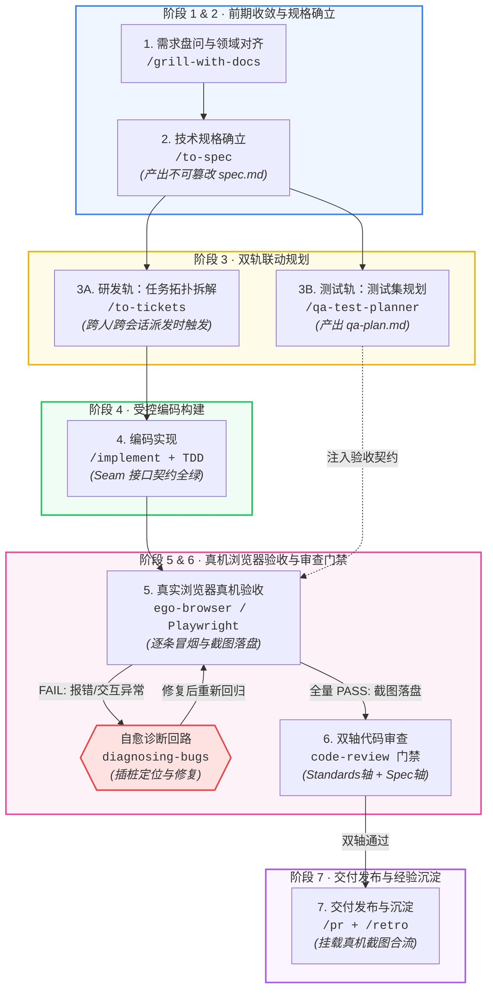

</details>

---

## 二、协同权限矩阵：开发者命令 vs 模型自主驱动

“这些斜杠命令，到底是我手动敲，还是 AI 模型自己调？”  
在项目的工程配置中，所有技能被严格划分为两类：**开发者独占闸门命令** 与 **通用协同技能**。

### 1. 开发者独占闸门命令（模型被禁调，防确认偏误）

以下命令在技能配置中显式声明了 `disable-model-invocation: true`。**模型绝对无法在后台自主发起调用，必须由人类开发者在对话框手动敲入**：

| 命令 | 核心职责 | 为什么禁止模型自调？（设计防呆理念） |
|:---|:---|:---|
| `/grill-with-docs` | 启动高压盘问并产出 ADR 架构决策 | 防止模型自问自答、自圆其说，必须由人类给出真实的业务边界判断。 |
| `/to-spec` | 将对齐共识固化为正式技术规格 | 技术规格是系统的“工程法典”，生成必须经过开发者明确审查确认。 |
| `/implement`<br>`/implement-spec` | 授权开启 TDD 批量编码实现 | 编码是产生代码变更的动作，开发者必须作为开工把关人。 |
| `/handoff` | 压缩当前会话并生成标准交接文档 | 会话中断或跨人交接属于人类意图决策，必须由人类触发并指定下阶段目标。 |
| `/grill-me` | 轻量级逻辑漏洞思维推演 | 属于辅助开发者理清思路的对话工具，非代码自动化工具。 |

### 2. 通用协同技能（双向均可调用，无缝人机协作）

以下技能**既允许模型在流水线中按需自主触发，也允许开发者随时手动敲斜杠命令调用**：

| 技能名称 | 命令触发 | 模型自调时机 | 开发者手动调用典型场景 |
|:---|:---|:---|:---|
| `qa-test-planner` | `/qa-test-planner` | 在 `/to-spec` 产出规格后，由流水线自动联动规划 | 想单独为某个老页面规划回归测试方案时 |
| `tdd` | `/tdd` | 在 `/implement` 内部循环执行单测红绿驱动 | 开发者想针对某个纯算法模块编写红绿测试时 |
| `diagnosing-bugs` | `/diagnosing-bugs` | 阶段 5 浏览器冒烟遇到 FAIL 时，自动触发根因诊断 | 本地突然遇到奇怪的报错，让 AI 协助排查时 |
| `ego-browser` | `/ego-browser` | 阶段 5 自动拉起真实浏览器逐条执行冒烟用例 | 开发者调试前端时，让 AI 帮忙打开浏览器并截图 |
| `code-review` | `/code-review` | 阶段 5 浏览器全绿后，交付前强制触发双轴审查 | 准备合并代码前，主动发起全量代码合规审计 |
| `pr` | `/pr` | 审查通过后，自动汇总截图与证据生成 PR | 手动整理 Pull Request 描述文档时 |
| `retro` | `/retro` | 交付完成后自主提议复盘 | 解决复杂架构难题或踩坑后，沉淀经验与教训 |

---

## 三、全景闭环流程与核心产物深度剖析（7 阶段详解）

### 阶段 1：需求盘问与领域对齐 (`/grill-with-docs`)

```
┌─────────────────────────────────────────────────────────────────────────┐
│                      【阶段 1：需求盘问与领域对齐流程】                   │
├─────────────────────────────────────────────────────────────────────────┤
│                                                                         │
│                       [ 原始粗糙业务需求输入 ]                          │
│                                  │                                      │
│                                  ▼                                      │
│                [ 启动高压盘问 /grill-with-docs ]                        │
│                主动挑战隐性假设、穷尽网络/鉴权边界与异常分支            │
│                                  │                                      │
│                                  ▼                                      │
│                [ 挂载 domain-modeling 术语核对 ]                        │
│                对照 GLOSSARY.md 统一步骤概念与领域语言                  │
│                                  │                                      │
│                                  ▼                                      │
│                      [ 评估重大技术取舍决策 ]                           │
│                                  │                                      │
│         ├───── 涉及跨模块/存储/长流契约 ───> 落盘架构决策记录 docs/adr/ │
│         └───── 常规局部改进与上下文对齐 ───> 更新全局上下文 CONTEXT.md │
│                                  │                                      │
│                                  ▼                                      │
│                      [ 止损线判定 (Stop Line) ]                         │
│                      剩余未决细节是否已不改变架构方向?                  │
│                                  │                                      │
│                 ├─ 否 (仍存在核心盲区) ─> 返回继续向人类盘问            │
│                 └─ 是 (已收敛) ────────> 果断进入阶段 2: /to-spec       │
│                                                                         │
└─────────────────────────────────────────────────────────────────────────┘
```

<details>
<summary><b>点击展开：Mermaid 状态流转图（支持渲染环境）</b></summary>

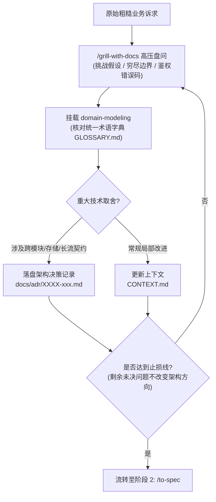

</details>

- **为什么叫“盘问 (Grilling)”？**：普通提问只是被动记录需求，而“盘问”是像严苛的系统架构师一样，主动挖掘隐藏盲区：
  - “当大模型输出到一半网络断开，客户端如何恢复？Token 扣减怎么算？”
  - “匿名用户与登录用户的存储隔离怎么做？设备指纹被风控了怎么降级？”
  - “高并发下多个请求同时修改历史记录，是否有竞态条件？”
- **止损线准则**：不追求前置推演 100% 的实现细节。**当剩余未澄清的细节已经不会颠覆核心数据流、接口签名和模块拓扑时，果断止损进入阶段 2**，边缘分支留待编码阶段按需决策。
- **核心产出样例**：`docs/adr/0009-unified-tool-stream-projector.md`（明确统一工具流事件投影适配器的架构接缝与权衡取舍）。

---

### 阶段 2：技术规格确立 (`/to-spec`) —— 契约、格式与对比

```
┌─────────────────────────────────────────────────────────────────────────┐
│              【核心三合一产物定位：Spec vs PRD vs Plan】                 │
├─────────────────────────────────────────────────────────────────────────┤
│                                                                         │
│   ┌──────────────────────────┐                                          │
│   │   PRD（产品需求文档）     │ 回答“做给谁用、商业价值是什么”          │
│   │   • 商业目标 / 用户画像  │ ❌ 痛点：通篇不提类名、函数名与 TS 类型  │
│   │   • 业务交互原型交互图   │                                          │
│   └─────────────┬────────────┘                                          │
│                 │ [向上承接商业诉求]                                    │
│                 ▼                                                       │
│   ┌────────────────────────────────────────────────────────┐            │
│   │   ⭐ Technical Spec（技术规格）── 系统法定契约          │            │
│   │   • Problem Statement: 维护者痛点与用户痛点            │            │
│   │   • User Stories: US-01 ~ US-NN 严格验收断言契约       │            │
│   │   • Implementation: 目录归属 / 导出类型 / 异常状态机   │            │
│   │   • Testing Strategy: Seam 接口单测 + 真机冒烟定位器   │            │
│   │   💡 定性：不可篡改的工程基准法典，开发与测试统一准绳   │            │
│   └─────────────┬──────────────────────────────────────────┘            │
│                 │ [向下指导精准工程施工]                                │
│                 ▼                                                       │
│   ┌──────────────────────────┐                                          │
│   │   Plan（施工步骤计划）   │ 回答“第一步做什么、第二步做什么”        │
│   │   • 步骤一建立文件       │ ❌ 痛点：只是一次性便签，施工完即作废    │
│   │   • 步骤二修改组件配置   │                                          │
│   └──────────────────────────┘                                          │
│                                                                         │
└─────────────────────────────────────────────────────────────────────────┘
```

<details>
<summary><b>点击展开：Mermaid 继承关系类图（支持渲染环境）</b></summary>

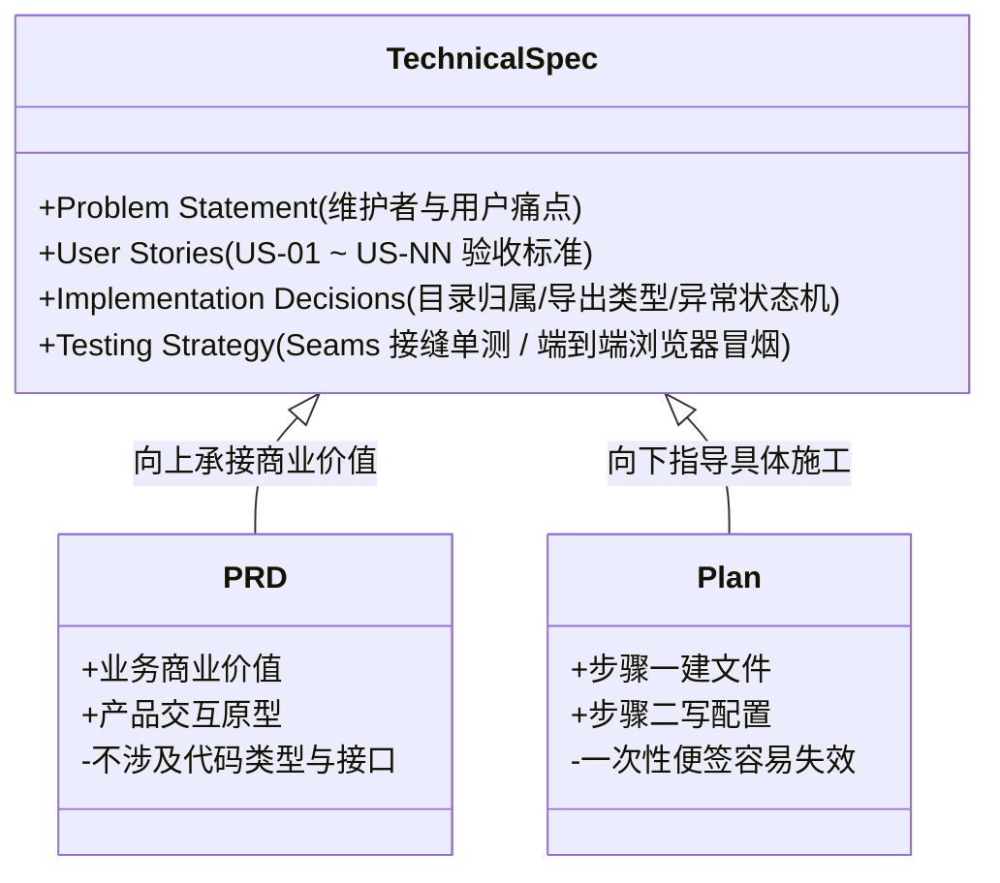

</details>

- **产物位置**：`.scratch/<feature>/spec.md`。
- **Spec vs PRD vs Plan 的本质区别**：
  - **PRD（产品需求）**：回答“做给谁用、有什么价值”，通篇不提类名、函数名与 TypeScript 类型；
  - **Plan（施工计划）**：回答“第一步改什么、第二步改什么”，只是一次性施工便签；
  - **Spec（技术规格）**：**系统接缝（Seams）与接口契约的法定合同**！它是只读的基准线，明确导出类型、错误码与边界断言，开发和测试必须以它为唯一准绳。
- **标准产物模板**：
  ```markdown
  # 聊天流过程旁白 · 技术规格
  Status: ready-for-agent
  来源：/grill-with-docs 共识 · ADR-0009
  
  ## Problem Statement
  - 最终用户痛点：大模型调用长耗时工具时界面静止，用户误以为卡死而频繁刷新；
  - 维护者痛点：前端缺乏统一的轻量级状态帧协议，扩展新工具需改动多层组件。
  
  ## User Stories
  - US-01: 作为用户，发起带工具调用的对话时，能实时看到「正在检索天气...」的淡入旁白；
  - US-02: 作为用户，在大模型正文生成开始时，旁白平滑收起至折叠状态；
  - US-03: 作为维护者，流解析层遇到未知的第三方事件帧时，必须静默丢弃而不是导致整个会话崩溃。
  
  ## Implementation Decisions
  1. 契约类型扩展：在 `packages/shared/src/chat-stream-contract.ts` 中维护流事件与工具帧联合类型；
  2. 接缝隔离：客户端流处理层 `apps/web/src/lib/utils/chat-stream.ts` 与状态管理 `apps/web/src/stores/chat-store.ts` 内部状态解耦，暴露独立的响应式状态。
  
  ## Testing Strategy
  1. 单元测试：在 `apps/web/src/lib/utils/chat-stream.test.ts` 中针对流状态投影编写确定性纯单测；
  2. 真实浏览器验收：在真实对话流（对应 `apps/web/e2e/chat.spec.ts` 链路）中实测旁白卡片的动画呈现与折叠。
  ```

---

### 阶段 3：双轨联动分工规划 (研发轨 3A vs 测试轨 3B)

当 `/to-spec` 产出规格后，研发轨与测试轨**同时启动、双轨并行**：

```
                   [ 阶段 2: 产出正式技术规格 spec.md ]
                                     │
                 ┌───────────────────┴───────────────────┐
                 ▼ (研发轨: 施工视角)                    ▼ (测试轨: 对抗视角)
   ┌───────────────────────────────┐       ┌───────────────────────────────┐
   │ 阶段 3A：工单拓扑拆解         │       │ 阶段 3B：端到端用例规划       │
   │ /to-tickets (条件触发)        │       │ /qa-test-planner              │
   │ 产出 issues/*.md 依赖 DAG     │       │ 产出 qa-plan.md 验收用例与断言│
   └──────────────┬────────────────┘       └──────────────┬────────────────┘
                  │                                       │
                  ▼                                       │
   ┌───────────────────────────────┐                      │
   │ 阶段 4：编码实现 (/implement) │                      │
   │ TDD 单测红绿循环保证内部契约  │                      │
   └──────────────┬────────────────┘                      │
                  │                                       │
                  └───────────────────┬───────────────────┘
                                      │ (双轨汇合：代码与验收用例双就绪)
                                      ▼
                       [ 阶段 5：真实浏览器真实验收 ]
```

<details>
<summary><b>点击展开：Mermaid 双轨时序图（支持渲染环境）</b></summary>

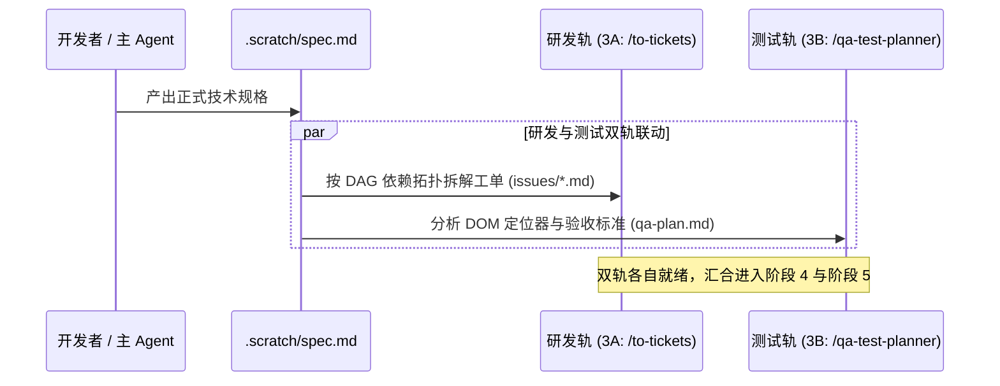

</details>

#### 阶段 3A：工单拓扑拆解 (`/to-tickets`) —— 触发条件与协作形态

> 💡 **本地目录澄清**：在本项目（托管于 Gitee，无 GitHub CLI）中，工单统一落盘在 **`.scratch/<feature>/issues/`** 目录下（按依赖编号，如 `01-contract.md`）。本地**只有 `issues/` 目录，没有 `tickets/` 目录**。

- **触发条件（按协作形态而非代码规模决策）**：
  - **需要拆解（生成 `issues/*.md`）**：预估需要**跨会话推进**、**跨人员交接**，或计划通过 `/implement-spec` 并发推进前沿工单；
  - **无需拆解（直接推进）**：单会话冲刺时，直接从 `spec.md` 中的 `## Work Orders` 小节起步执行，**不拆碎文件**，避免规格文件与碎片文件的多头同步摩擦。
- **工单有向无环图 (DAG) 样例**：

```
       ┌────────────────────────────────────────────────────────┐
       │ 01-contract.md: 数据契约与类型定义 (Blocked by: None)   │
       └───────────────────────────┬────────────────────────────┘
                                   │
                  ┌────────────────┴────────────────┐
                  ▼                                 ▼
   ┌─────────────────────────────┐   ┌─────────────────────────────┐
   │ 02-stream-parser.md         │   │ 03-note-ui.md               │
   │ 客户端流解析层 (Blocked: 01)│   │ 旁白组件独立渲染(Blocked:01)│
   └──────────────┬──────────────┘   └──────────────┬──────────────┘
                  │                                 │
                  └────────────────┬────────────────┘
                                   ▼
       ┌────────────────────────────────────────────────────────┐
       │ 04-integration.md: 聊天页面整合装配 (Blocked by: 02, 03)│
       └────────────────────────────────────────────────────────┘
```

<details>
<summary><b>点击展开：Mermaid 依赖拓扑图（支持渲染环境）</b></summary>

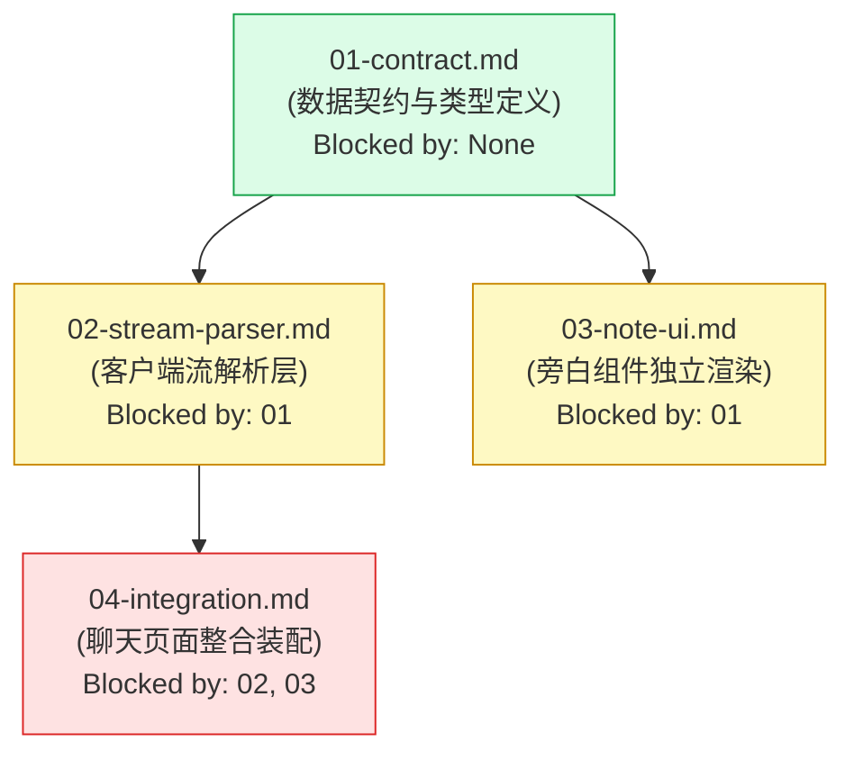

</details>

#### 阶段 3B：端到端用例规划 (`/qa-test-planner`) —— QA 对抗性思维

- **QA 对抗性思维 vs 开发者自测**：
  - 开发者容易顺向思考：“我只要传对参数，能返回结果就算好了”；
  - QA 站在真实用户甚至“破坏者”角度：“如果用户在加载中连续点击 10 次按钮会怎样？”、“如果弱网下首帧返回延迟 5 秒，页面会不会水合崩溃？”。
- **产物位置**：`.scratch/<feature>/qa-plan.md`。
- **三大规划原则**：
  1. **分级清晰**：明确标识 `[P0]`（核心 Happy Path / 阻断性链路）、`[P1]`（重要分支校验）、`[P2]`（边缘兜底）；
  2. **自动化友好定位器**：优先提取具备语义化、高稳定性的定位特征（如 `aria-label="..."`、`placeholder="..."` 或文案 `text="发送"`）；
  3. **量化预期断言**：**严禁写“页面表现正常”等废话**！必须具体到“页面弹出 Toast 提示‘发送成功’且网络面板截获 POST /api/chat 状态码为 200”。

---

### 阶段 4：测试驱动实现 (`/implement` + `tdd`) —— 红绿灯真相与模式分流

#### 彻底破除对 TDD 的最大误解

> ❌ **常见误解**：“红灯测试是故意写一个错误的用法去触发异常。”  
> ✅ **工程真相**：“红灯测试是**一个完全正确、完全符合业务契约、对未来接口提出合理预期的正面测试**！它现在之所以报错（红灯），仅仅是因为**功能代码目前还没写出来**！”

```
┌─────────────────────────────────────────────────────────────────────────┐
│                      【TDD 经典红-绿-重构循环】                           │
├─────────────────────────────────────────────────────────────────────────┤
│                                                                         │
│        ┌────────────────────────────────────────────────────────┐       │
│        │  🔴 红灯阶段 (Red)                                     │ <──┐  │
│        │  编写符合技术规格的“正确测试” (断言业务契约与未来接口) │    │  │
│        │  运行测试报错红灯 ──> 证明测试真实具备拦截与验证能力   │    │  │
│        └───────────────────────────┬────────────────────────────┘    │  │
│                                    │                                 │  │
│                                    ▼                                 │  │
│        ┌────────────────────────────────────────────────────────┐    │  │
│        │  🟢 绿灯阶段 (Green)                                   │    │  │
│        │  编写极简的业务功能代码 (不做多余设计)                 │    │  │
│        │  运行测试全绿 ──> 验证当前功能契约已初步实现           │    │  │
│        └───────────────────────────┬────────────────────────────┘    │  │
│                                    │                                 │  │
│                                    ▼                                 │  │
│        ┌────────────────────────────────────────────────────────┐    │  │
│        │  🔵 重构阶段 (Refactor)                                │    │  │
│        │  提炼结构、清除重复坏味道、优化性能                   │    │  │
│        │  确保测试 100% 持续全绿 ──> 在单测安全网下放心重构     │ ───┘  │
│        └────────────────────────────────────────────────────────┘       │
│                                                                         │
└─────────────────────────────────────────────────────────────────────────┘
```

<details>
<summary><b>点击展开：Mermaid 循环图（支持渲染环境）</b></summary>

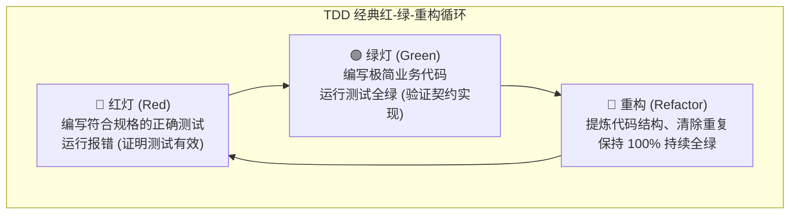

</details>

#### 阶段 4 三大实现范式：单工单微调 vs 批量连续冲刺 vs 并发派发 (/implement-spec)

在技术规格（`spec.md`）和工单依赖图就绪后，流水线支持三种**不同粒度与并发度**的实现范式，团队可按特性规模与风险等级自由选择：

| 维度 / 范式 | 模式 A：单工单微调模式<br>(Single Ticket Debug) | 模式 B：单会话批量冲刺<br>(Batch Sequential Sprint) | 模式 C：多子代理并发派发<br>(Parallel Worktree Swarm) |
|:---|:---|:---|:---|
| **触发命令** | `/implement 工单 01` | `/implement --all` 或 `/implement` (无参) | `/implement-spec` |
| **执行载体** | 当前主会话单线逐步推进 | 当前主会话单线连续推进 | 调度多个后台子 Agent 并发推进 |
| **分支与隔离** | 当前开发分支原地单点实现 | 当前开发分支原地顺次推进 | 自动拉出 `integration-branch`，每个工单在**独立 Git Worktree + 专属子分支**隔离执行 |
| **推进机制** | 单工单完成后停下交出控制权，向人类汇报并等待下一指令 | 沿 DAG 拓扑顺序串行冲刺，内部自动翻转状态为 `done`，中途不停顿 | 动态计算拓扑前沿（Frontier），并发派发多个 Implementer Subagents 同步跑 TDD |
| **汇聚与回归** | 人类确认后按需开启下一张 | 全量工单编码全绿后一次性交付，主动流转阶段 5 浏览器验收 | 由 Merger Agent 滚动合并回集成分支，全部完成后由主 Agent 接管真实验收，自动清理 Worktree |
| **适用场景** | 核心架构重构、疑难 Bug 排查、需人类步步复核的高危场景 | 常见多工单业务开发（工单 2~5 张），拓扑清晰，**日常研发强力推荐** | 模块解耦度高的大型特性（工单 ≥ 4 张），追求极限并发效率与完全分支隔离 |

---

##### 1. 模式 A 与 模式 B 流向对比（单会话内部）

```
┌───────────────────────────────────────┐       ┌───────────────────────────────────────┐
│     模式 A：单工单调试模式 (精细排障)   │       │   模式 B：批量连续冲刺模式 (推荐高效实践) │
├───────────────────────────────────────┤       ├───────────────────────────────────────┤
│                                       │       │                                       │
│  [触发指令]                           │       │  [触发指令]                           │
│  /implement 工单 01                   │       │  /implement --all 或 批量开工 01-NN   │
│                 │                     │       │                 │                     │
│                 ▼                     │       │                 ▼                     │
│  [受控实现]                           │       │  [拓扑遍历]                           │
│  TDD 红绿循环实现该工单契约           │       │  顺次解析工单依赖图 (DAG 拓扑序)      │
│                 │                     │       │                 │                     │
│                 ▼                     │       │                 ▼ <────────────────┐  │
│  [状态更新]                           │       │  [执行单张工单]                    │  │
│  单测全绿，标记工单 issue 01 为 done  │       │  TDD 红绿实现工单 N 代码与测试     │  │
│                 │                     │       │                 │                  │  │
│                 ▼                     │       │                 ▼                  │  │
│  [停顿汇报] (主动交出控制权)          │       │  [自动流转]                        │  │
│  停下向人类汇报，等待下一工单指令     │       │  内部静默改写 status 为 done       │  │
│                                       │       │                 │                  │  │
│                                       │       │                 ▼                  │  │
│  特点：精细受控，步步为营             │       │  [分支判断] 是否还有就绪工单?      │  │
│  场景：核心架构重构、疑难缺陷摸索     │       │     ├─────── 是 (存在待办) ────────┘  │
│                                       │       │     │                                 │
│                                       │       │     ▼ 否 (全部工单编码完成)           │
│                                       │       │  [全量静态门禁]                       │
│                                       │       │  运行全量 typecheck + 单测套件全绿    │
│                                       │       │                 │                     │
│                                       │       │                 ▼                     │
│                                       │       │  [无缝流转]                           │
│                                       │       │  输出交付矩阵，主动流转阶段 5 浏览器  │
│                                       │       │                                       │
│                                       │       │  特点：消除流程摩擦，零停顿连续冲刺   │
│                                       │       │  场景：标准化多工单特性研发 (默认推荐) │
└───────────────────────────────────────┘       └───────────────────────────────────────┘
```

<details>
<summary><b>点击展开：模式 A 与 模式 B Mermaid 流向图</b></summary>

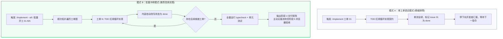

</details>

---

##### 2. 模式 C：多子代理并发派发模式 (`/implement-spec`)

当工单数量较多（如 4~8 张工单），且多张工单之间不存在单链阻塞、具备高解耦度时，开发者可直接调用 **`/implement-spec`** 开启**多子代理并发派发模式**。

该模式严格遵循 `.claude/skills/implement-spec/SKILL.md` 的规范，通过**独立分支与隔离 Git Worktree** 实现全自动并发构建与滚动合流：

```
┌────────────────────────────────────────────────────────────────────────────────────────┐
│                 【模式 C：/implement-spec 多子代理并发派发与回归架构流】                │
├────────────────────────────────────────────────────────────────────────────────────────┤
│                                                                                        │
│   [ 开发者触发 /implement-spec 闸门命令 ]                                              │
│                  │                                                                     │
│                  ▼                                                                     │
│   [ 步骤 1：建立隔离基准 ] ────> 自动拉出专属集成主分支 (git checkout -b integration)  │
│                  │                                                                     │
│                  ▼                                                                     │
│   [ 步骤 2：探测拓扑前沿 ] ────> 解析 issues/*.md 计算当前无阻塞的工单集 (Frontier)    │
│                  │                                                                     │
│                  ▼                                                                     │
│   [ 步骤 3：并发派发 Implementer Subagents 集群 (后台最大并发) ]                       │
│                  │                                                                     │
│         ┌────────┴────────────────────────┬────────────────────────┐                   │
│         ▼                                 ▼                        ▼                   │
│   ┌───────────────────────────┐     ┌───────────────────────────┐  ... (更多前沿工单)  │
│   │ [Implementer Subagent 01] │     │ [Implementer Subagent 02] │                      │
│   │ • 独立 Git Worktree 目录  │     │ • 独立 Git Worktree 目录  │                      │
│   │ • 独立特性子分支 01-branch│     │ • 独立特性子分支 02-branch│                      │
│   │ • 内部驱动 tdd 红绿单测   │     │ • 内部驱动 tdd 红绿单测   │                      │
│   │ • 完工前拉取集成最新代码  │     │ • 完工前拉取集成最新代码  │                      │
│   └─────────────┬─────────────┘     └─────────────┬─────────────┘                      │
│                 │                                 │                                    │
│                 ▼                                 ▼                                    │
│   [ 步骤 4：Merger Agent 滚动合流与前沿向前推进 ] <────────────────────────────────────┘
│   子分支测试通过 ──> 自动合并回 integration 主分支 ──> 动态解锁下一批前沿工单并发开工! │
│                  │                                                                     │
│                  ▼ (全部工单编码完成，整份 Spec 拓扑全绿)                              │
│   [ 步骤 5：主编排 Agent 接管真机门禁 (项目特化核心防线) ]                             │
│   1. 主编排 Agent 在 integration 分支上执行阶段 5 真实浏览器验收 (子代理严禁越权)     │
│   2. 真实浏览器全量通过后，触发阶段 6 code-review 双轴代码审查门禁                     │
│   3. 自动彻底清理全部子代理临时 Git Worktree 目录与子分支                              │
│                  │                                                                     │
│                  ▼                                                                     │
│   [ 输出 Draft PR 或交付完全通过的集成主分支 ]                                         │
│                                                                                        │
└────────────────────────────────────────────────────────────────────────────────────────┘
```

<details>
<summary><b>点击展开：模式 C Mermaid 并发与回归拓扑图</b></summary>

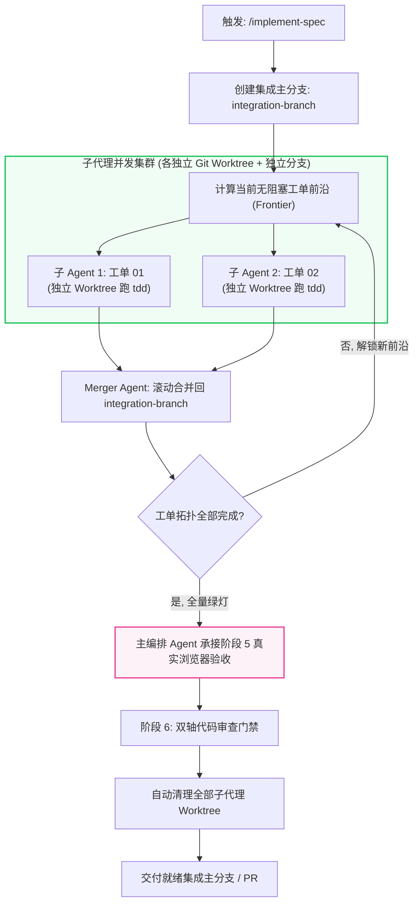

</details>

- **三大模式选型速记**：
  - **模式 A（精细单调）**：复杂高危、核心重构，每走一步由人类亲自把舵；
  - **模式 B（批量冲刺，日常首选）**：单会话无缝连冲，中途不打断人类，最适合日常大部分业务开发；
  - **模式 C（并发集群，极速重器）**：多工单独立解耦的大型特性，派发子 Agent 在独立 Worktree 并行开发，兼顾极限速度与沙箱安全。

---

### 阶段 5：真实浏览器验收卡点 (核心质量红线)

这是本工作流最具特色、也是彻底杜绝前端缺陷的**核心硬核防线**。

```
┌─────────────────────────────────────────────────────────────────────────┐
│                      【阶段 5：真实浏览器验收全景流】                     │
├─────────────────────────────────────────────────────────────────────────┤
│                                                                         │
│   [ 阶段 5 开启 ]                                                       │
│          │                                                              │
│          ▼                                                              │
│   [ 步骤 1：三级自愈探活 ] ──(未就绪/端口漂移)──> 自动后台拉起 pnpm dev:web │
│   curl 探活 3030 / 扫描 3031-3059 锚点        (轮询等待 60-90s)        │
│          │ (200 且锚点正确)                                             │
│          ▼                                                              │
│   [ 步骤 2：定位器快速校准 ]                                             │
│   对照实现微调 selector / aria (断言严禁妥协)                           │
│          │                                                              │
│          ▼                                                              │
│   [ 步骤 3：执行工具分级选择 ]                                           │
│          ├───── macOS 桌面环境 ──────> 首选 ego-browser (可视窗口/真实Cookie)│
│          └───── Linux/CI 无头环境 ───> 平滑降级 Playwright (无头自动化) │
│          │                                                              │
│          ▼                                                              │
│   [ 步骤 4：水合就绪锚点确认 ]                                           │
│   显式等待客户端水合 DOM 就绪 (严禁使用 networkidle 等待)               │
│          │                                                              │
│          ▼                                                              │
│   [ 步骤 5：逐条执行冒烟用例 ] <──────────────────────────────────────┐ │
│   按 qa-plan.md 执行交互与断言                                        │ │
│          │                                                            │ │
│          ├───── [ FAIL 报错 / 交互异常 ] ─────────────────────────────┤ │
│          │      1. 抓取现场截图 TC01-场景名-FAIL-时间戳.png           │ │
│          │      2. 记录 Console 报错与网络状态                        │ │
│          │      3. 触发 diagnosing-bugs 自愈回路 (插桩排查修复代码)───┘ │
│          │                                                              │
│          ▼                                                              │
│   [ 步骤 6：全量 PASS 证据归档 ]                                        │
│   1. 截图落盘 TC01-场景名.png (存入 .scratch/<feature>/screenshots/)    │
│   2. 回填追加 ## 执行记录 到 qa-plan.md                                 │
│   3. 核心用例固化为本地回归代码 (apps/web/e2e/*.spec.ts)                │
│          │                                                              │
│          ▼                                                              │
│   [ 流转至阶段 6: 双轴代码审查门禁 ]                                    │
└─────────────────────────────────────────────────────────────────────────┘
```

<details>
<summary><b>点击展开：Mermaid 执行状态机（支持渲染环境）</b></summary>

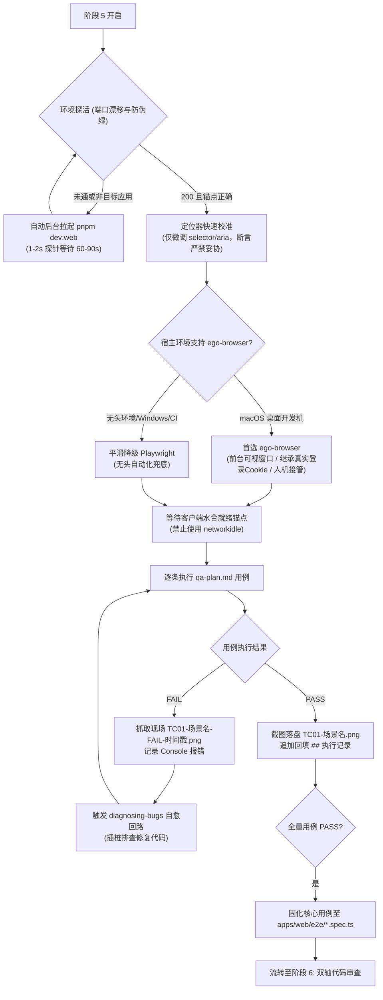

</details>

#### 1. 三级自愈环境探活与端口防漂移

前端本地开发常因端口占用导致 Next.js 端口漂移（从 3030 漂移到 3031~3059）。流水线制定了严格的三级无人值守探活策略：
1. **优先探活**：`curl -s -o /dev/null -w "%{http_code}" http://localhost:3030` 确认 200；
2. **扫描漂移与防伪绿**：若 3030 不通，自动扫描 3031–3059 区间；**抓取页面 HTML 确认目标应用特征锚点**，防止误连上一会话残留的陈旧服务；
3. **自愈拉起**：若均未就绪，后台自动执行 `pnpm dev:web`，每 1~2 秒轮询探活，预留 60~90 秒覆盖冷启动与编译；
4. **铁律红线**：**严禁随意 kill 占用端口的进程**（可能是用户正在运行的其他重要服务）；**严禁将连接拒绝（ERR_CONNECTION_REFUSED）误当成业务代码 Bug 排查**！

#### 2. 客户端就绪锚点（防 SSR 水合假死）

Next.js 采用服务端渲染（SSR），页面 HTML 加载完成时不代表 JavaScript 事件监听器已经挂载完毕！
- **反模式**：盲目使用 `waitForLoadState('networkidle')` —— 由于开发模式下 HMR（热更新）心跳和 SSE 长流连接始终存在，网络**永远不会空闲**，导致测试超时崩溃；
- **正确做法**：显式等待**“客户端水合完成后才会出现的特征 DOM”**（如带有 `placeholder="输入消息…"` 的输入框处于可点击状态，或 AuthGuard 加载动画结束）。

#### 3. 定位器校准机制（定位可调，断言严禁妥协）

`qa-plan.md` 往往在编码实现前就已经由测试轨规划好，定位器属性是预估的：
- **允许就地校准**：进入浏览器前，允许对照实现代码微调选择器（例如原预估 `role="button"` 改为实际的 `aria-label="提交"`），并在 `## 执行记录` 留存一行校准痕迹；
- **断言铁律**：**严禁篡改业务预期与断言**！如果实现结果与预期的文案不符，属于需求偏差，必须留待审查解决，绝不能靠改测试用例来掩耳盗铃。

#### 4. 执行工具分级铁律（`ego-browser` 首选 vs `Playwright` 降级）

| 维度 | 第一优先级：`ego-browser`（首选） | 第二优先级：`Playwright`（降级与固化） |
|:---|:---|:---|
| **核心机制** | 真实 Chromium 前台可视窗口，多步骤单脚本批处理 | 本地 Node.js 进程无头自动化驱动 |
| **登录态** | **天然继承宿主浏览器真实登录凭证与 Cookie**，直达业务界面 | 每次需从头 mock 设备指纹或匿名账号 |
| **协同体验** | 人类可肉眼实时看到 Agent 的点击轨迹，遇验证码可**人工随时接管** | 纯后台黑盒运行，无法直观干预 |
| **适用环境** | macOS 桌面开发机（交互验收首选） | Linux/Windows/无桌面 CI 流水线（平滑降级通道） |
| **职责分工** | **本次改动的新功能首次交互验收**与 PR 截图截取 | **固化为 CI 长期自动化回归代码**（`apps/web/e2e/*.spec.ts`） |

#### 5. 异步链路终态验收机制

对于涉及后台任务队列的异步链路（如“图像生成”、“视频生成”、“语音转写”）：
- **“提交成功”绝不算 PASS**：页面提示“已提交”不代表业务成功，必须验收至**终态**（生成出真实图像/视频，或明确展示可解析的失败态）；
- **前置健康检查**：轮询前先确认后台 Worker 进程（BullMQ）存活且上游凭证有效；
- **防无限等待**：严格遵循时间盒限制，超时记为 FAIL；
- **服务端证据链**：必须提供一条服务端证据（Worker 控制台日志、数据库记录或 Redis 队列状态三选一）。

#### 6. 异常自愈回路与 Before/After 证据闭环

- **执行记录回填**：浏览器跑通一条，Agent 在 `qa-plan.md` 的 `## 执行记录` 实时追加一条 PASS；
- **Before/After 证据链**：
  - 成功截图命名：`TC01-chat-stream-pass.png`；
  - 失败现场截图：`TC01-chat-stream-FAIL-20261015103000.png`；
  - 修复后回归：执行记录同时关联 FAIL 现场图与 PASS 图，形成清晰的故障修复闭环证据。

---

### 阶段 6：双轴代码审查 (`code-review` 交付前必经硬门禁)

在真实浏览器全量通过后，**严禁直接提交代码或声称交付完成**！必须主动触发双轴代码审查。  
本阶段**深度继承了 Matt Pocock 原创的双轴子代理架构**（Standards 规范轴 + Spec 需求轴分别由两个子代理独立并行执行，互不污染上下文），并在此基础上进行了实战深化：从单纯产出报告升级为**交付前的强制阻断门禁**，注入平台特化规范（安全密钥零入日志、移动端点击热区 ≥ 44×44px、代码与注释全量中文规范），并确立了**「本次修 / 转专项 / 驳回」三档分流处置机制**与涉及核心链路重回浏览器复验的闭环回路。

```
┌─────────────────────────────────────────────────────────────────────────┐
│                      【阶段 6：双轴代码审查门禁全景流】                   │
├─────────────────────────────────────────────────────────────────────────┤
│                                                                         │
│                   [ 阶段 5 真实浏览器真机验收全量 PASS ]                │
│                                      │                                  │
│                                      ▼                                  │
│                 [ 触发 code-review 双轴代码审查门禁 ]                   │
│                                      │                                  │
│             ┌────────────────────────┴────────────────────────┐         │
│             ▼                                                 ▼         │
│   ┌───────────────────────────┐     ┌───────────────────────────────┐   │
│   │   规范轴 (Standards)      │     │       需求轴 (Spec)           │   │
│   ├───────────────────────────┤     ├───────────────────────────────┤   │
│   │• 敏感信息：密钥零入日志   │     │• 逐条核验 spec.md 全部 US 契约│   │
│   │• 移动端：点击热区≥44x44   │     │• 完整性：遗漏 US 视为重大缺陷 │   │
│   │• 工程规范：Next.js / 缓存 │     │• 对抗性对账：严防实现与测试同 │   │
│   │• 清洁度：代码注释全量中文 │     │  源偏误（防两个都理解错了）   │   │
│   └─────────────┬─────────────┘     └───────────────┬───────────────┘   │
│                 │                                   │                   │
│                 └─────────────────┬─────────────────┘                   │
│                                   │                                     │
│                                   ▼                                     │
│                     [ 审查发现缺陷：三档分流策略 ]                      │
│                                   │                                     │
│         ┌─────────────────────────┼─────────────────────────┐           │
│         ▼ [本次修]                ▼ [转专项]                ▼ [驳回]    │
│  ┌──────────────────────┐  ┌──────────────────────┐  ┌────────────────┐ │
│  │ 琐碎且安全的单点改动 │  │ 涉及跨模块较大改动   │  │ 属 ADR 既定决策│ │
│  │ 当前分支立即就地修复 │  │ 记入 qa-plan.md      │  │ 记录理由并关闭 │ │
│  └──────────┬───────────┘  │ ## 遗留事项 后续提单 │  └───────┬────────┘ │
│             │              └──────────┬───────────┘          │          │
│   [ 是否触及核心链路? ]               │                      │          │
│      ├─ 是 ──> 截图失效，重回浏览器   │                      │          │
│      │         复验并重新截图落盘     │                      │          │
│      └─ 否 ──> 仅回归单测与静态检查   │                      │          │
│             │                         │                      │          │
│             ▼                         ▼                      ▼          │
│  ┌───────────────────────────────────────────────────────────────────┐  │
│  │                     [ 审查通过，解锁交付提议 ]                    │  │
│  │         允许进入阶段 7 整理 PR 描述，严禁擅自自动 commit          │  │
│  └───────────────────────────────────────────────────────────────────┘  │
└─────────────────────────────────────────────────────────────────────────┘
```

<details>
<summary><b>点击展开：Mermaid 审查分流状态机（支持渲染环境）</b></summary>

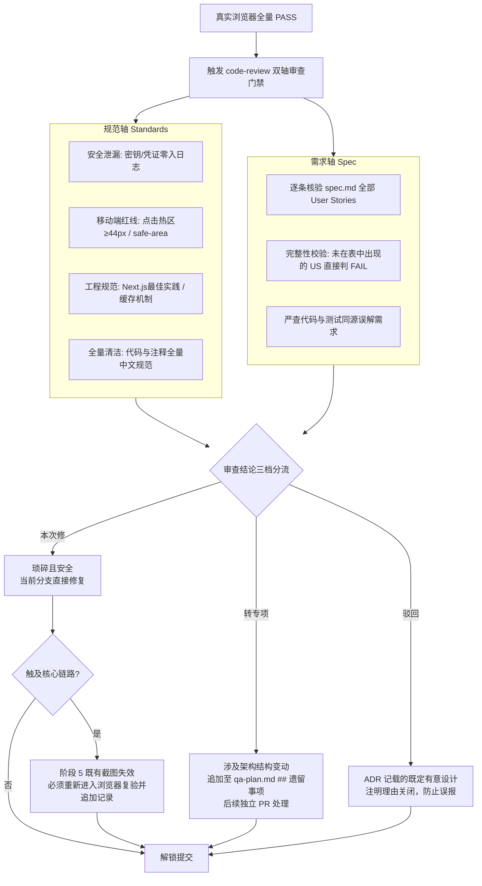

</details>

#### 1. 规范轴 (Standards) 对账表

规范轴绝不仅是检查格式，它由**「代码本身质量基线」**与**「项目平台级工程硬指标」**两大部分深度融合构成：

##### (1) 代码本身质量基线：Martin Fowler 12 大经典代码坏味道 (Smell Baseline)
`.claude/skills/code-review/SKILL.md` 的规范轴内置了 Martin Fowler《重构》核心坏味道基线，重点审查代码本身的冗余与过度设计（启发式判定，跳过编译器已拦截的语法错误）：
- **Duplicated Code（重复/冗余代码）**：相同的逻辑形态在多个代码块或文件中重复出现 ──> **必须提炼为单一共享函数**，双向复用；
- **Speculative Generality（夸夸其谈 / 过度抽象）**：编写了当前 `spec.md` 根本没有要求的扩展参数、过度封装的工厂层或未使用的通用钩子 ──> **果断删除，直接内联**，避免死代码与虚妄的扩展性；
- **Middle Man（中间人传递 / 无意义转发）**：一个类或函数几乎不做任何实质工作，仅仅充当传话筒往下一层转发 ──> **剔除中间人**，调用方直接直连目标；
- **Mysterious Name（晦涩命名）**：函数、变量、类型命名含混不清，无法一眼看出其承载的业务意图 ──> **重命名为自解释的语义化名称**；
- **Primitive Obsession（基本类型偏执）**：用泛滥的裸 `string` 或 `number` 代替本该清晰定义的领域值对象 ──> **赋予专有的 TypeScript 强类型**；
- **Data Clumps（数据泥团）**：几个参数或字段总是在多个函数间形影不离地一起传递 ──> **打包抽象为专有的接口或类型**；
- **Feature Envy（依恋情结）**：某个方法调用另一个对象的数据远多于自身 ──> **将方法搬移到它所依赖的数据所属模块**；
- **Repeated Switches（重复条件分支）**：多处出现针对同一类型的 `switch` 或 `if-else` 级联 ──> **改用策略字典映射或多态消除**；
- **Shotgun Surgery（霰弹式修改）** 与 **Divergent Change（发散式变化）**：一个逻辑改动迫使散落编辑多个无关文件，或单个文件因为多种无关理由被修改 ──> **重新聚拢高内聚职责边界**。

##### (2) 平台级特化红线与工程规范
在通用代码坏味道之上，深度叠加本项目不可妥协的工程铁律：
- **安全零泄漏红线**：严禁 API Key、密码、用户私密 Token 泄漏到前端日志、URL 参数或 SSE 事件流中；
- **移动端触控红线**：所有可交互按钮与链接的触控热区必须 ≥ 44×44px，页面底部固定区域必须完整适配 iPhone 底部黑条与刘海屏（`safe-area-inset`）；
- **工程纪律与包依赖**：跨应用共享必须经 `packages/`，禁止应用间跨界直引；Zustand Store 走直接路径导入，禁止 barrel 引用；
- **全量语言清洁原则**：修改的文件中**严禁残留任何存量英文注释**，即使与本次改动无关也必须顺手汉化翻译，保持全中文代码库洁净。

#### 2. 需求轴 (Spec) 对账表与完整性校验

- **完整性校验法则**：对照 `spec.md` 中的全部 User Stories（`US-01 ~ US-NN`）逐一核对。**对账表中只要有任何一个需求编号被遗漏，需求轴直接判定为 FAIL**！
- 示例对账表：
  ```markdown
  ### Spec 需求轴对账结果
  - US-01~02：PASS（过程旁白正常淡入并收起，证据：01-TC01-pass.png）
  - US-03：PASS（单元测试 `apps/web/src/lib/utils/chat-stream.test.ts` 验证未知帧静默丢弃）
  ```

#### 3. 审查结论三档分流与复验回路

发现的所有问题，严格划分为三档处置：
1. **本次修**：简单且安全的微调，当前直接修掉；**若触及核心链路，必须回退到阶段 5 重新截图复验**；
2. **转专项**：涉及较大架构改动的清理，记入 `qa-plan.md` 的 `## 遗留事项`，后续独立提工单处理，不混入当前交付；
3. **驳回**：确认为 ADR 记录过的有意设计，明确说明理由并关闭。

---

### 阶段 7：交付发布与经验沉淀 (`pr` + `/retro`)

```
┌─────────────────────────────────────────────────────────────────────────┐
│                      【阶段 7：交付发布与经验沉淀流程】                   │
├─────────────────────────────────────────────────────────────────────────┤
│                                                                         │
│   [ 阶段 6 双轴审查通过 ]                                               │
│             │                                                           │
│             ▼                                                           │
│   [ 触发 pr 交付技能 ]                                                  │
│   自动聚合 .scratch/<feature>/screenshots/ 真实对比截图与遗留事项       │
│             │                                                           │
│             ▼                                                           │
│   [ 生成图文并茂的 PR 描述文档 ]                                        │
│   包含：问题背景、技术决策、Before/After 真机证据链、遗留项跟踪         │
│             │                                                           │
│             ▼                                                           │
│   [ 开发者人工确认与终审 ]                                              │
│   🛑【安全红线】严禁 AI 擅自自动执行 git commit / git push              │
│   由具备真实身份的开发者核对后手工执行提交与推仓                        │
│             │                                                           │
│             ▼ (完成复杂特性、重大重构或遭遇踩坑)                        │
│   [ 触发 /retro 复盘机制 ]                                              │
│   沉淀避坑经验至 docs/adr/，动态调优 qa-workflow 规则与防呆门禁         │
│                                                                         │
└─────────────────────────────────────────────────────────────────────────┘
```

<details>
<summary><b>点击展开：Mermaid 交付时序图（支持渲染环境）</b></summary>

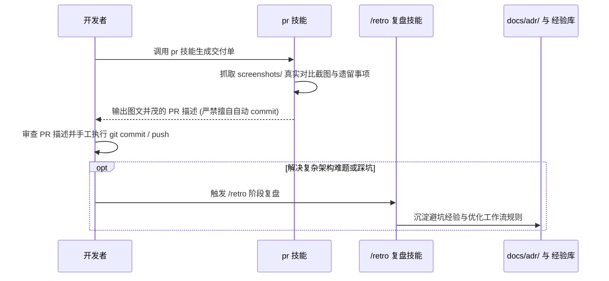

</details>

- **人工终审心法**：
  1. 首先对照 `spec.md` 核查验收标准与真实测试截图——重点判断**“测试是否真正锁定了业务关心的核心行为，而不是自欺欺人的无谓断言”**；
  2. 快速扫视双轴审查的高危告警项；
  3. 常规实现代码充分信任单测与类型检查，避免逐行逐字纠结陷入疲劳。
- **关于 Git Commit 的铁律**：`pr` 技能只负责生成包含截图的 PR 描述文档，**严禁代理任何未经开发者明确确认的 git commit 操作**！

---

## 四、实战杠杆：思维快捷键 (`prompt-shortcuts.md`) 如何配合工作流？

在翻阅仓库时会看到 `docs/agents/prompt-shortcuts.md` 这个文件，可能会有疑问：“它在流水线里到底怎么运行的？模型会自动读它吗？”

一句话定性：**它不是流水线在后台自动执行的脚本，模型在跑常规流程时也不会自动阅读它。它是给人类工程师准备的「杠杆工具箱」——用最少字数的标准短语，在关键节点撬动 AI 改变思考模式。**

```
┌────────────────────────────────────────────────────────────────────────────────────────┐
│               【思维快捷键 (prompt-shortcuts.md) 挂载与介入机制全景图】                  │
├────────────────────────────────────────────────────────────────────────────────────────┤
│                                                                                        │
│   [ 工作流 7 阶段标准主干道 ]                 [ 人类工程师认知纠偏杠杆 (按需撬动深度) ]   │
│   (规定研发节奏：什么时候做什么)              (纯思维工具：不自动执行，遇到盲区时手动敲入)│
│                                                                                        │
│    ┌────────────────────────┐                                                          │
│    │ 阶段 1：需求盘问与对齐 │ <══════════ [ 对抗性审查 ]  打破顺从讨好，挖掘反例与盲区   │
│    └───────────┬────────────┘ <══════════ [ 第一性原理 ]  拆掉惯性补丁，推倒重构本质解法 │
│                │                                                                       │
│                ▼                                                                       │
│    ┌────────────────────────┐                                                          │
│    │ 阶段 2：技术规格确立   │                                                          │
│    └───────────┬────────────┘                                                          │
│                │                                                                       │
│                ▼                                                                       │
│    ┌────────────────────────┐                                                          │
│    │ 阶段 3：双轨联动规划   │                                                          │
│    └───────────┬────────────┘                                                          │
│                │                                                                       │
│                ▼                                                                       │
│    ┌────────────────────────┐                                                          │
│    │ 阶段 4：编码实现 (TDD) │ ── (由阶段 4 三大实现范式受控推进，不设认知干预)         │
│    └───────────┬────────────┘                                                          │
│                │                                                                       │
│                ▼                                                                       │
│    ┌────────────────────────┐                                                          │
│    │ 阶段 5：浏览器真实验收 │                                                          │
│    └───────────┬────────────┘                                                          │
│                │                                                                       │
│                ▼                                                                       │
│    ┌────────────────────────┐                                                          │
│    │ 阶段 6：双轴代码审查   │ <══════════ [ 奥卡姆剃刀 ] 承接审查“转专项”，利用 Deletion Test │
│    └───────────┬────────────┘                          清理冗余抽象与无意义工厂层      │
│                │                                                                       │
│                ▼                                                                       │
│    ┌────────────────────────┐                                                          │
│    │ 阶段 7：交付发布与复盘 │ <══════════ [ 消融实验 ] 逐项剥离优化项，量化真实独立贡献 │
│    └────────────────────────┘                                                          │
│                                                                                        │
│  💡 协作定性：工作流负责定规矩、保底线（下限）；思维快捷键负责人按需触发、拔高认知（上限）。│
└────────────────────────────────────────────────────────────────────────────────────────┘
```

<details>
<summary><b>点击展开：Mermaid 流程图（支持渲染环境）</b></summary>

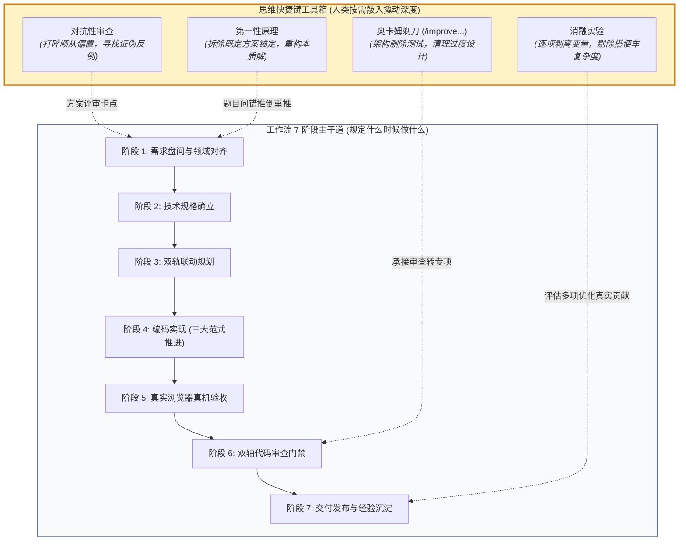

</details>

### 1. 为什么不让流水线自动执行这些方法？（防过度工程）

大语言模型如果缺乏约束，容易陷入两种极端：要么盲目顺从，要么过度设计。  
如果流水线在每一步都自动跑“第一性原理”或“消融实验”，就会出现“改一个按钮颜色都要推翻整套底层架构从零推导”的灾难。因此：
- **`qa-workflow.md` 负责定轨道**：确保按部就班快速产出、测试并验收，不跑偏；
- **`prompt-shortcuts.md` 负责按需纠偏**：只在人类觉得思考陷入盲区、或者逻辑越修越复杂时，由人亲自掏出来撬动一次。

> 💡 **职责边界澄清**：关于阶段 4 的具体任务执行方式（如单工单调试、`/implement --all` 批量冲刺、`/implement-spec` 并发派发），属于**工程推进范式**，已在第三节阶段 4 详尽阐述；本节工具箱专注于人类工程师在关键节点按需敲入的 **4 大纯认知级思维纠偏杠杆**。

---

### 2. 核心配合场景与即插即用指令字典

在实际协作中，遇到以下 4 种陷入思维盲区的场景时，直接把文件中的标准短语复制到对话框中：

#### 场景 1：阶段 1 方案讨论陷入“顺从讨好”时 ── 敲入「对抗性审查」
- **配合时机**：阶段 1 需求对齐或方案初稿评审时；
- **典型现象**：AI 表现得像一个没有主见的顺从者，你提什么方案它都夸“很好、很完善”，但你凭工程直觉感觉有高并发、网络弱网或脏数据风险；
- **直接对 AI 说**：
  > *「对这个方案做对抗性审查，优先寻找能推翻核心假设的反例，不要帮它找理由。」*
- **激活模型机制**：强行打破大模型的谄媚偏置（Sycophancy），逼迫其从“合谋者”转为“攻击者”，主动挖掘幂等性、超时雪崩、存储死锁等极端盲区。

#### 场景 2：需求陷入修修补补的死胡同时 ── 敲入「第一性原理」
- **配合时机**：阶段 1 或阶段 2，发现讨论一直在给老旧设计的坏味道打补丁、越改越重时；
- **典型现象**：大家在讨论“怎么加一个全局 Map、再加一个事件总线来解决数据不同步”，陷入了惯性优化的泥潭；
- **直接对 AI 说**：
  > *「不要基于现有方案继续设计，从第一性原理重新分析这个问题到底该怎么解。」*
- **激活模型机制**：彻底拆掉既定代码的“锚定效应”，退回到问题最原始的本质约束（例如“本质上只是单向流数据刷新，为什么不直接利用 React 缓存？”），往往能用极简方案替代复杂补丁。

#### 场景 3：阶段 6 双轴审查分流出复杂坏味道时 ── 敲入「奥卡姆剃刀（结构清理）」
- **配合时机**：阶段 6 审查发现某模块多层过度抽象，结论划入“转专项”时；
- **典型现象**：当前特性开发功能虽然绿了，但代码里多出了无意义的工厂层和封装，想清理又怕影响当前发布；
- **直接对 AI 说**：
  > *「直接调用 /improve-codebase-architecture 进行专项结构清理。」*
- **激活模型机制**：该技能内置架构删除测试（Deletion Test），并感知全局 ADR；它会针对冗余代码进行大胆精简，同时确保已有 1300+ 个单元测试一行不断，既去除了臃肿，又不会误伤有意设计的接缝。

#### 场景 4：引入多项优化后评估收益时 ── 敲入「消融实验」
- **配合时机**：阶段 7 或性能调优合并后；
- **典型现象**：为了优化首屏渲染，同时加了“本地缓存、动态分包、预加载接口”三项改动，虽然整体变快了，但不知道到底是哪个起作用、哪个只是“搭便车的无效复杂度”；
- **直接对 AI 说**：
  > *「给这几项改动设计消融实验，逐项评估独立贡献。」*
- **激活模型机制**：以 Baseline 基准为起点，逐个剔除改动变量（Ablation），精准量化每一项的真实收益，果断删除只增加复杂度却毫无明显收益的冗余代码。

---

## 五、快慢车道剪裁与红线原则（按需剪裁，不搞一刀切）

### 1. 三档车道决策树与适用标准

Matt Pocock 原版技能的本意是一套供开发者按需手动调用的“热插拔技能箱”。而在团队工程化协作中，为了兼顾**“模块热插拔的高灵活性”**与**“团队交付的高确定性”**，流水线绝不搞教条主义一刀切，而是通过白纸黑字的决策树进行自适应剪裁：小改动极速走快车道，核心改动守死真实验收门禁。

```
┌──────────────────────────────────────────────────────────────────────────────────┐
│                           【三档车道剪裁决策树】                                   │
├──────────────────────────────────────────────────────────────────────────────────┤
│                                                                                  │
│                                 [ 新任务进入评估 ]                               │
│                                          │                                       │
│                                          ▼                                       │
│                         [ 判断 1 ] 是否触及六大核心链路?                          │
│                         (认证/流式对话/图像/视频/语音/计费)                      │
│                                 │                 │                              │
│                           [ 是：触及核心 ]   [ 否：未触及 ]                      │
│                                 │                 │                              │
│                                 ▼                 ▼                              │
│            [ 判断 2 ] 协作形态与改动规模?       [ 判断 3 ] 改动极小?             │
│                 │               │               (纯文案/极简样式/单点修复)       │
│                 │               │                 │               │              │
│       [ 跨模块/跨人/深重构 ] [ 单会话独立新功能 ] [ 否：中型改动 ]     [ 是 ]             │
│                 │               │                 │               │              │
│                 ▼               ▼                 ▼               ▼              │
│          ┌──────────────┐┌──────────────┐                  ┌──────────────┐      │
│          │  🔴 慢车道   ││  🟡 标准车道 │                  │  🟢 快车道   │      │
│          │  Full Track  ││Standard Track│ <────────────────┘  Fast Track  │      │
│          ├──────────────┤├──────────────┤                  ├──────────────┤      │
│          │• 完整7阶段全 ││• 阶段2技术规 │                  │• 免写大Spec  │      │
│          │  流程闭环    ││  格 /to-spec │                  │• 直接开始编码│      │
│          │• /grill-docs ││• 阶段3B测试规│                  │  /implement  │      │
│          │  高压盘问ADR ││  划 /qa-plan │                  │• TDD红绿单测 │      │
│          │• 阶段3A工单  ││• 阶段4受控编 │                  │  锁定Seam接缝│      │
│          │  DAG拓扑拆解 ││  码 (跳过3A) │                  │• 触及P0链路  │      │
│          │• 浏览器真机  ││• 浏览器真机  │                  │  时自查冒烟  │      │
│          │  全绿冒烟    ││  验收 + 截图 │                  │• 快速审查交付│      │
│          │• 双轴审查门禁││• 双轴代码审查│                  │  /pr         │      │
│          │• PR + 复盘   ││• 交付 /pr    │                  │              │      │
│          └──────────────┘└──────────────┘                  └──────────────┘      │
└──────────────────────────────────────────────────────────────────────────────────┘
```

<details>
<summary><b>点击展开：Mermaid 车道决策树（支持渲染环境）</b></summary>

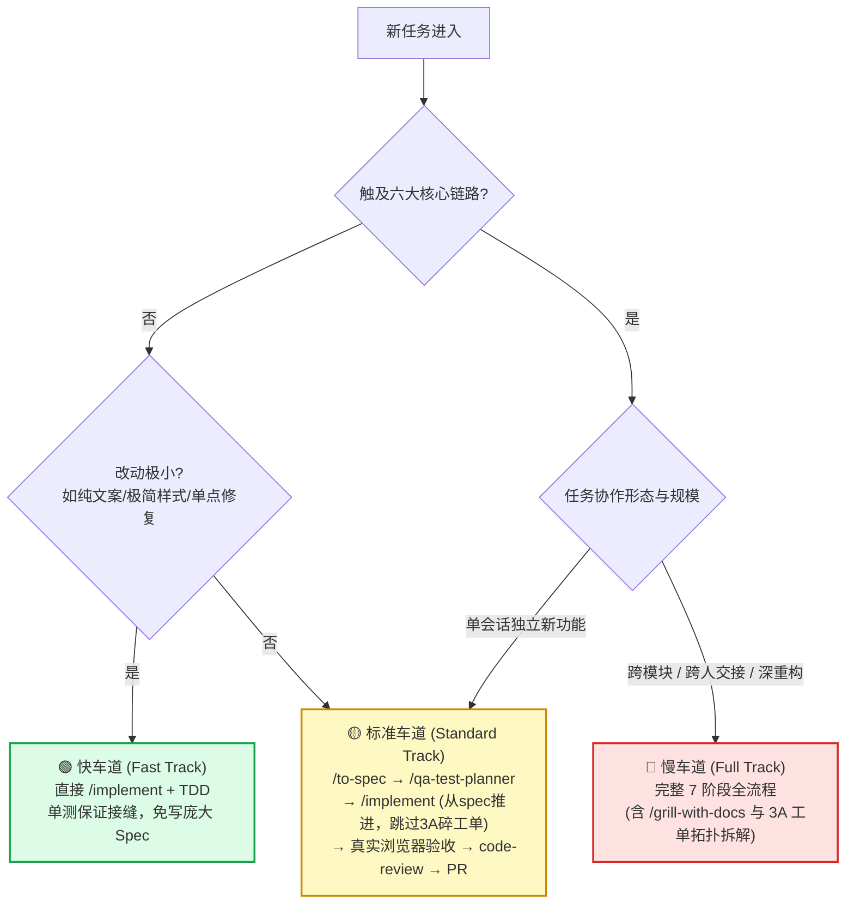

</details>

### 2. 不可剪裁的六大核心红线链路

无论走哪条车道，只要代码改动涉及以下**六大用户可见核心链路**，**阶段 5 的真实浏览器验收绝对不可跳过**：

```
🛡️ 平台不可违背的六大核心红线链路：
1. 身份认证：登录 / 登出 / Token 刷新 / 匿名会话初始化
2. 流式对话：Chat SSE 流式响应 / 思考过程折叠 / 手动停止生成
3. 图像生成：模型切换 / 提示词提交 / 任务排队与结果呈现
4. 视频生成：参数配置 / 异步轮询 / 视频播放与异常提示
5. 语音转写：麦克风录音 / 音频文件上传 / 实时波形与转写文本
6. 计费结算：Token 消耗统计 / 额度扣减与欠费弹窗阻断
```

> 💡 **主动扩展**：如果你开发的新页面（如“个人资产中心”或“命理排盘主图”）不在上述列表中，但具备用户交互界面，同样极力推荐执行浏览器真机验收！

### 3. 15 分钟时间盒与分流机制

避免交互式验收陷入无休止的时间消耗：

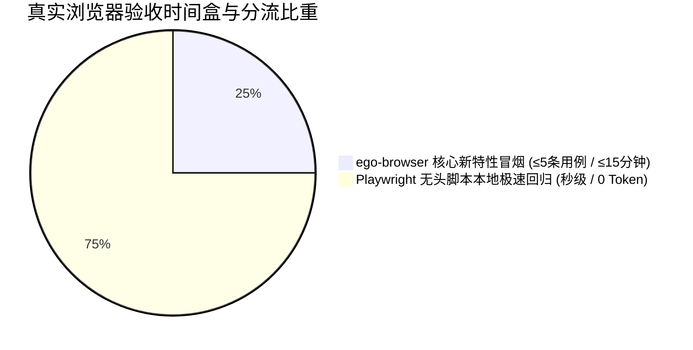

- **用例数量收敛**：`ego-browser` 交互验收仅聚焦本次改动最核心的 **3~5 条 P0 冒烟用例**，单次耗时控制在 **15 分钟** 时间盒内；
- **全站存量回归交给 Playwright**：存量页面的防破坏回归全部交给本地 E2E 脚本（`pnpm --filter @repo/web test:e2e`），秒级完成，不浪费大模型视觉 Token。

---

## 六、跨会话与跨人交接契约（断点无缝续接）

在日常协作中，一个大任务可能由于 Token 达到上限、下班断点或多人协作而跨越多个会话。本工作流天生具备**“零上下文丢失”**的接力能力。

```
┌────────────────────────────────────────────────────────────────────────────────────────┐
│                   【跨会话与跨人交接双轨机制全景流】                                     │
├────────────────────────────────────────────────────────────────────────────────────────┤
│                                                                                        │
│                 [ 当前会话遭遇中断点 (Token上限 / 下班断点 / 换人交接) ]               │
│                                      │                                                 │
│             ┌────────────────────────┴────────────────────────┐                        │
│             ▼                                                 ▼                        │
│   ┌───────────────────────────┐     ┌──────────────────────────────────────────────┐   │
│   │ 方式 A：轻量对话模板唤起  │     │ 方式 B：/handoff 标准化交接文档 (强力推荐)   │   │
│   │ (同人同机、轻量快速续接)  │     │ (深度复杂、跨人协作、跨机器交接)             │   │
│   ├───────────────────────────┤     ├──────────────────────────────────────────────┤   │
│   │ 开发者直接使用标准化模板  │     │ 开发者手动敲入独占命令：                     │   │
│   │ 在新对话框直发给 Agent    │     │ /handoff "说明下一会话的目标与关注重点"      │   │
│   │                           │     │                                              │   │
│   │ 核心依赖磁盘既有产物：    │     │ 技能自动浓缩并收敛于工作区落盘：             │   │
│   │ .scratch/<feature>/       │     │ • 本地断点续接：.scratch/<feature>/handoff.md│   │
│   │  ├── spec.md              │     │ • 跨人/跨机交接：docs/handoff/<日期>-slug.md │   │
│   │  ├── qa-plan.md           │     │                                              │   │
│   │  └── screenshots/         │     │ 包含：断点进展、Suggested Skills、路径引用   │   │
│   └─────────────┬─────────────┘     └──────────────────────┬───────────────────────┘   │
│                 │                                          │                           │
│                 ▼                                          ▼                           │
│   ┌───────────────────────────┐     ┌──────────────────────────────────────────────┐   │
│   │ 新会话输入：              │     │ 新会话输入（极简一句话）：                   │   │
│   │ 复制场景模板(如场景一/二) │     │ 「请阅读交接文档 <工作区路径>，              │   │
│   │ 指向 spec.md 或 qa-plan.md│     │  严格按其中的建议技能和目标继续推进。」      │   │
│   └─────────────┬─────────────┘     └──────────────────────┬───────────────────────┘   │
│                 │                                          │                           │
│                 └─────────────────────┬────────────────────┘                           │
│                                       │                                                │
│                                       ▼                                                │
│                 [ 新 Agent 零上下文丢失，秒级无缝接力开工 ]                            │
│                                                                                        │
└────────────────────────────────────────────────────────────────────────────────────────┘
```

### 1. 状态完全落盘契约

所有关键上下文均不依赖聊天窗口记忆，全部持久化存储在磁盘中：

```
.scratch/<feature>/
├── spec.md                     # 阶段 2 技术规格与契约合同
├── issues/                     # 阶段 3A 拆解出的 DAG 工单文件 (可选)
│   ├── 01-contract.md
│   └── 02-parser.md
├── qa-plan.md                  # 阶段 3B 测试计划与阶段 5 执行记录 (含 PASS/FAIL)
├── screenshots/                # 阶段 5 截取的真实浏览器现场图片
│   ├── TC01-pass.png
│   └── TC02-FAIL-20261015.png
└── handoff.md                  # /handoff 生成的本地同机会话交接文档 (断点续接)
```

### 2. 标准化交接文档机制 (`/handoff` 技能，强力推荐)

除了口头对话描述外，工作流深度集成了 **`.claude/skills/handoff/SKILL.md`** 标准化交接技能。它是解决长会话断点、换人协作最优雅的工程方案。

#### (1) 如何生成交接文档？
在当前会话即将结束、达到 Token 预算或需要下班交接时，开发者在对话框敲入 `/handoff` 闸门命令，并附带下一阶段的目标：
```bash
/handoff "下一会话开启批量冲刺实现工单 01-04，并完成阶段 5 浏览器验收"
```

#### (2) `/handoff` 技能的核心行为规范
- **自动提炼进展与断点**：总结当前会话已达成的工程成果、尚未解决的阻断问题（Blockers）；
- **声明建议技能集 (`Suggested Skills`)**：根据当前所处阶段，显式建议新 Agent 在开工后优先调用的技能（如建议调用 `/implement`、`ego-browser`、`code-review` 等）；
- **严禁正文重复冗余**：**绝不**将 `spec.md`、`qa-plan.md`、代码 diff 或 ADR 的大段正文复制进交接文档，一律通过文件相对路径引用，保持交接文档极度精炼、节省新会话上下文；
- **全量凭证脱敏**：自动擦除会话中出现的 API Key、测试账密、Cookie 或私密 Token；
- **严格遵循工作区落盘规范（严禁写入系统 /tmp）**：
  - **默认同机断点续接（单机流转，不入库）**：自动保存至当前特性工作区 **`.scratch/<feature>/handoff.md`**（若无特定特性，存至 `.scratch/handoff/<日期>-<slug>.md`），与规格、测试计划同级归档；
  - **跨团队成员交接 / 跨机器流转（版本化入库）**：落盘至 **`docs/handoff/<日期>-<slug>.md`**，随 Git 提交归档，团队其他同事拉取代码后即可直接接力。

#### (3) 新会话如何极简唤起接力？
在新开启的会话中，开发者完全**无需再花时间重复敲入长篇背景**，只需给 Agent 发送极简的一句话指令：
> *「请阅读交接文档 `.scratch/<feature-name>/handoff.md`（或 `docs/handoff/2026-10-01-chat-agent-tools-phase1-to-phase2.md`），严格按照其中的建议技能和指引继续推进。」*

Agent 读入该文档后，即可瞬间还原所有前序工程共识与测试断点，零偏差无缝开工！

---

### 3. 轻量对话精准唤起话术模板库

在无需生成正式交接文档的轻量级场景下，也可以直接复制以下模板在对话框中唤起新 Agent：

```markdown
<!-- 场景一：技术规格已定，新会话开启批量冲刺实现 -->
「我已完成了 <feature-name> 的规格与测试规划。请先阅读 .scratch/<feature-name>/spec.md 和 .scratch/<feature-name>/qa-plan.md 了解契约，然后直接以批量冲刺模式运行 /implement 开启 TDD 编码实现，单测全绿后主动流转至浏览器验收。」

<!-- 场景二：编码已完成，新会话接力启动真机验收 -->
「<feature-name> 的业务代码与单测均已就绪。请阅读 .scratch/<feature-name>/qa-plan.md，执行阶段 5 的真实浏览器验收。务必先通过 curl 探活 3030 端口，优先调用 ego-browser 逐条执行用例，将截图存入 .scratch/<feature-name>/screenshots/ 并回填执行记录。」

<!-- 场景三：排查中断，接力未通过的失败用例 -->
「请阅读 .scratch/<feature-name>/qa-plan.md 末尾的 ## 执行记录，聚焦尚未 PASS 的失败用例，调用 diagnosing-bugs 插桩定位并修复，修复后重新在浏览器中回归验证。」
```

---

## 七、实战避坑指南与排障心法

### 坑 1：未探活即开浏览器，连接拒绝误判为业务 Bug

- **灾难场景**：Agent 唤起浏览器访问 `http://localhost:3030`，屏幕提示 `ERR_CONNECTION_REFUSED`。Agent 误以为路由代码写炸了，疯狂修改 Next.js 配置文件和业务代码。
- **正规解法**：操作浏览器前，必须通过命令行静默探活：
  ```bash
  curl -s -o /dev/null -w "%{http_code}" http://localhost:3030
  ```
  若返回 000 表明服务未启动，先拉起服务，严禁将网络不可达当作业务 Bug。

---

### 坑 2：盲目等待网络空闲，SSR 水合假死导致误报

- **灾难场景**：自动化脚本等待 `networkidle` 超时；或者页面 HTML 刚渲染出来，React 水合尚未完成，脚本猛点按钮毫无反应，误报“按钮点击无效”。
- **正规解法**：
  1. 坚决弃用 `networkidle` 等待策略；
  2. 采用**客户端就绪锚点**：必须显式等待水合完成标志性元素（如已绑好点击事件的按钮或特定容器）挂载后再执行交互。

---

### 坑 3：上游网络阻断或欠费，盲目改动业务代码（三层隔离探针链）

```
┌─────────────────────────────────────────────────────────────────────────┐
│                      【三层隔离探针链判定流程】                           │
├─────────────────────────────────────────────────────────────────────────┤
│                                                                         │
│                   [ 遇到上游接口报错 500 / 403 / 超时 ]                 │
│                                      │                                  │
│                                      ▼                                  │
│  ┌───────────────────────────────────────────────────────────────────┐  │
│  │ 第 1 层：裸 curl 独立探针 (网络、鉴权与防火墙隔离)                  │  │
│  │ 作用：完全绕过项目所有代码与环境变量，裸调上游官方 OpenAPI 端点   │  │
│  └───────────────────────────────────┬───────────────────────────────┘  │
│                                      │                                  │
│                 ├──── [ 裸 curl 失败 ] ──> 确定为外部网络阻断/欠费/防火墙│
│                 │                          🛑【严禁修改任何业务代码！】 │
│                 │                                                       │
│                 ▼ [ 裸 curl 响应正常 ]                                  │
│  ┌───────────────────────────────────────────────────────────────────┐  │
│  │ 第 2 层：官方 SDK 独立微脚本 (依赖版本与参数签名隔离)             │  │
│  │ 作用：单文件脚本直接调用官方 SDK 最简 Hello World 样例             │  │
│  └───────────────────────────────────┬───────────────────────────────┘  │
│                                      │                                  │
│                 ├──── [ SDK 脚本失败 ] ──> 确定为 SDK 依赖版本或签名问题│
│                 │                          🛑【锁定依赖问题，不动业务】 │
│                 │                                                       │
│                 ▼ [ SDK 脚本运行成功 ]                                  │
│  ┌───────────────────────────────────────────────────────────────────┐  │
│  │ 第 3 层：项目适配器接缝探针 (内部数据流与序列化定界)              │  │
│  │ 作用：仅接入项目本地 Adapter 与数据映射层                         │  │
│  └───────────────────────────────────┬───────────────────────────────┘  │
│                                      │                                  │
│                                      ▼                                  │
│                 [ 锁定内部数据契约与参数映射缺陷 ]                      │
│                 此时才开始在本地安全精准修复业务代码                    │
└─────────────────────────────────────────────────────────────────────────┘
```

<details>
<summary><b>点击展开：Mermaid 探针流向图（支持渲染环境）</b></summary>

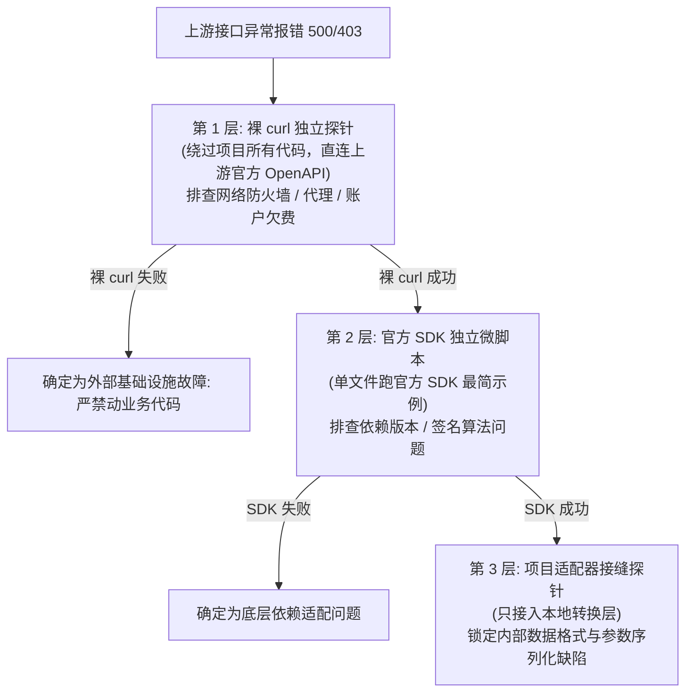

</details>

- **心法精髓**：遇到接口异常，在工作区写一个完全独立的单文件测试微脚本（如 `.scratch/<feature>/probe-ark.mts`），一层层向内推进定界，**严禁在未排查隔离前盲目修改已有的业务代码**！

---

### 坑 4：强杀端口造成协作冲突

- **灾难场景**：发现 3030 端口被占，直接执行 `kill -9 $(lsof -t -i:3030)`，误杀了同事或者自己在其他窗口运行的调试进程。
- **正规解法**：利用项目自带的端口漂移决议脚本（`tooling/scripts/dev-port.mjs`），在 3031~3059 寻找可用端口平滑启动，绝不野蛮杀进程。

---

## 八、常见疑问解答 (FAQ)

### Q1：我只改个页面文案或者换个按钮颜色，也必须跑完这 7 个阶段吗？
**答：绝对不需要！**  
请对照[第五节快慢车道决策树](#五快慢车道剪裁与红线原则按需剪裁不搞一刀切)，极简改动直接走**快车道**：改完后跑一下单测和类型检查，确认无误即可提交。只有改动触及六大核心链路（如影响登录、对话收发等）或开发新功能时，才强制浏览器真实验收。

### Q2：`ego-browser` 弹出窗口后，我能直接用鼠标进去点吗？
**答：能，而且这正是它的最大设计优势！**  
`ego-browser` 是专为人机协同设计的真机浏览器。当 Agent 遇到滑块验证码、需要手机短信登录，或者在复杂的页面交互卡壳时，**人类随时可以抢过鼠标接管操作**，协助解决卡点后再让 Agent 继续执行。

### Q3：如果我们在没有图形界面的 Linux CI 服务器上跑，怎么验收？
**答：流水线已内置无缝降级通道！**  
在没有桌面图形环境的系统上，流水线会自动平滑降级为无头 **`Playwright`** 驱动执行，完全不阻塞持续集成。同时核心链路已固化为 `apps/web/e2e/*.spec.ts`，在 CI 中直接通过 `pnpm test:e2e` 执行。

### Q4：为什么规范严厉禁止让 AI 自主执行 `git commit`？
**答：为了坚守代码责任边界。**  
Git 提交历史代表着工程师的专业信誉与法定责任。AI 可以帮我们编写完美的 PR 总结并挂载截图，但最后的 `git commit` 和代码推仓动作，必须由具备真实身份的工程师确认后亲自执行，防止未经审查的隐蔽变更溜入主干。

### Q5：测试用例跑失败了，我能不能直接改改断言让它变绿？
**答：严禁篡改断言！**  
如果真实页面表现与断言不符，只允许调整**“如何找到该元素”的定位器（如选择器由 class 改为 aria-label）**；预期的业务行为断言（如“必须显示 200”或“必须展示成功状态”）严禁妥协。随意改弱断言等于掩耳盗铃，抹杀了测试的防线价值。

### Q6：遇到长耗时的异步任务（比如生成视频要等 1 分钟），浏览器验收会不会超时卡死？
**答：不会，规范定义了完整的异步链路终态验收机制。**  
用例会设定合理的超时上限并以非阻塞间隔轮询后台终态，同时会提前校验后台 Worker 进程是否健康；一旦超时会自动熔断并输出堆栈，绝不会无限死等。

### Q7：`/pr` 技能的产物到底是什么？在什么场景下使用？
**答：它的产物是一份带完整可信证据链的 Pull Request 描述 Markdown 文档，用于准备向远程仓库提交 PR / MR 时使用。**  
1. **不会替你自动提交代码**：项目坚守 Git 责任边界，`/pr` **绝不自动执行** `git commit` 或 `git push`；
2. **核心产物内容**：它会自动扫描本次改动的核心要素，生成图文并茂的交付单：
   - **改动摘要与爆炸半径**：清晰说明修改了哪些模块、影响范围有多大；
   - **Before/After 浏览器真机证据链**：自动抓取 `.scratch/<feature>/screenshots/` 里的全部真实浏览器截图（如成功截图 `TC01-pass.png` 与修复前的 `TC01-FAIL.png`），自动转换为 Markdown 图片引用嵌入到 PR 描述中；
   - **遗留事项透明化**：自动把阶段 6 双轴审查分流出的 `## 遗留事项` 带入 PR，公开给代码审查者（Reviewer）；
3. **典型使用场景**：当特性编码完成、单测全绿、真实浏览器验收通过、双轴审查无阻断后，输入 `/pr`，然后直接把生成的 Markdown 复制到 Gitee/GitLab/GitHub 的 PR 描述框即可，免去人工截图贴图和手写说明的繁琐工作。

### Q8：`/retro` 技能的产物是什么？沉淀之后是怎么保证下次不踩坑的？是和 Claude Code 记忆结合了吗，还是工具自己会自动记忆？
**答：必须澄清：大模型不会“凭空自动记住”，防踩坑依靠的是「知识工程化与代码化」，而不是玄学记忆！**  
1. **破除误区：模型会话结束后是无状态的（Stateless）**：
   当前窗口关闭后，底层大模型的神经网络权重并未改变，下次开新窗口它不会“自动通灵”记住上次的教训；哪怕是某些工具自带的本地记忆库，如果只是散乱地存一句话，随着上下文压缩或项目切换也很容易被遗忘或稀释。
2. **`/retro` 的真实物理产物**：
   - **架构决策落盘（`docs/adr/XXXX-xxx.md`）**：将重大的技术取舍与踩坑根因写成标准 ADR，成为仓库演进的历史事实源；
   - **代码库硬规则沉淀（`CLAUDE.md` / `.claude/rules/` / `qa-workflow.md`）**：将高频踩坑点提炼为具有指令约束力的规则，随 Git 入库分发给全团队；
   - **实战教案与反模式案例（`docs/teach/`）**：记录疑难杂症的诊断分析路径。
3. **怎么保证下次不踩坑？——「代码化 + 规则常驻」双重固化**：
   - **防线一：转化为常驻系统规则（Rules）**：例如踩过了“Next.js SSR 水合假死导致点击失效”的坑，`/retro` 会将“严禁使用 networkidle，必须以客户端水合特征 DOM 为就绪锚点”直接沉淀写入 `CLAUDE.md`。下次任何人在任何新会话中启动 Agent，该规则作为系统指令在会话伊始就已常驻生效；
   - **防线二：转化为确定性的回归测试代码（Regression Tests）**：将此次踩坑场景直接编写为一个永久运行的 Vitest 单测或 Playwright E2E 脚本（`apps/web/e2e/*.spec.ts`）。下次只要有任何人或 AI 再次写出引发该 Bug 的代码，**CI 构建和本地测试直接红灯拦截报错**，连编译都过不去；
   - **规则的自我进化与剪裁**：如果某条旧规则在后续实战中发现反复带来无效折腾，`/retro` 还会提案删减它，保证工程规则库始终精炼、高信噪比。  
   简言之：**把教训变成随代码仓库 Git 分发的硬规则和自动化测试用例，用代码防代码，才是 100% 保证下次不踩坑的科学方式！**

### Q9：工作流的核心是通过 `CLAUDE.md` 注入的提示词吗？这算不算仅仅是“软约束”？实际模型执行了什么、有没有阳奉阴违，开发者自己能知道吗？
**答：这绝不仅是文本层面的软约束，而是「意图规则（Prompt）+ 物理证据链卡点（磁盘产物）+ 权限硬闸门」构成的立体硬门禁！**

1. **为什么纯 Prompt 是不可靠的软约束？**  
   如果工作流仅仅依靠在提示词里写“请你写代码前先测试、交付前要严格审查”，那确实是软约束——大模型受“直接答题偏置（Direct Answer Bias）”驱动，经常会口头答应，实际上自己写了一堆代码就声称“我已经严格测试且完美完成了”。
2. **本工作流是如何将软约束“物理硬化”的？**
   - **物理证据链落盘（不可伪造）**：
     - 需求阶段必须生成 `.scratch/<feature>/spec.md`；
     - 测试阶段必须生成 `.scratch/<feature>/qa-plan.md`；
     - 阶段 5 必须启动真实 Chromium 浏览器（`ego-browser`），并**真实在磁盘 `.scratch/<feature>/screenshots/` 中生成 PNG 屏幕截图**！
     - 阶段 6 必须出具 User Stories 对账表与三档分流结论。  
     **AI 无法凭空捏造一个不存在的物理截图文件，开发者打开磁盘目录一眼就能看到真实的点击交互画面与错误现场**。
   - **技能配置层硬闸门（`disable-model-invocation: true`）**：
     在技能配置底层直接禁调（`/grill-with-docs`、`/to-spec`、`/implement`、`/handoff`），模型物理上根本调不动这些闸门命令，必须由人类亲自在终端敲入。
   - **代码推仓终审硬红线**：
     `CLAUDE.md` 严令禁止 AI 代理 `git commit`。如果 Agent 拿不出真实浏览器截图和双轴对账结果，人类开发者直接拒绝执行 commit，构成了无法被绕过的制度锁。
3. **流程自检门禁声明（Execution Gate）**：  
   `CLAUDE.md` 强制要求 Agent 在开工首轮回复开头必须显式打印自检状态栏（QA 阶段、核心链路判定、浏览器验收计划、审查状态）。只要模型试图跳过规则直接贴代码，未声明门禁状态就是**当场现行违规**，开发者可瞬间识别并打回。

### Q10：每次对话会不会都把 `qa-workflow.md` 或整本指南塞到会话上下文里？这样是不是极其浪费 Token？
**答：绝对不会！整套工作流采用了「极简常驻索引 + 按需局部调阅 + 提示词缓存（Prompt Cache）」的三层节约架构，常驻消耗极小：**

1. **主上下文只常驻极简的 `CLAUDE.md` 规则索引**：
   - 注入在 System Prompt 中的只有 `CLAUDE.md`，它是一份高度精炼的原则清单，整份文件仅几百 Token；
   - `CLAUDE.md` 明文规定：`参考资料见 docs/project-guide.md、docs/agents/，按需阅读，不要凭记忆引用`。因此，长达数千行的 `qa-workflow.md` 和本指南（Guide）**平时根本不在会话上下文里**，绝不会每轮重复灌入！
2. **按需按阶段动态阅读（On-demand Reading）**：
   - 只有当流程推进到特定阶段（如准备规划测试、或准备执行阶段 5 浏览器探活）时，Agent 才会通过 `Read` 工具针对性地读取那几行具体指令；
   - `.claude/rules/` 体系也采用了路径动态命中机制（如只有触及页面代码才激活 `ui.md`），最大化精简全局上下文。
### Q11：随着对话轮次变多、上下文变得很长，模型会不会发生注意力衰减（Attention Drift），把 `CLAUDE.md` 里的流程纪律给忘掉？
**答：这确实是大语言模型的底层天性（长上下文注意力稀释），但本工作流通过三道工程防线彻底解决了这一问题：**

1. **防线一：系统提示词（System Prompt）槽位的注意力锚定**：  
   `CLAUDE.md` 作为系统级指令，在 Harness 机制中始终锁定在最前端的特权槽位，无论中间聊了多少轮技术细节，底层注意力权重始终维持在该规则上，不会被普通对话内容挤掉。
2. **防线二：回复首部的「流程自检门禁」强迫模型激活注意力**：  
   大模型在长对话中最容易犯的毛病是“顺着人类最后一句话惯性作答（直接写码）”。因此 `CLAUDE.md` 设定了**回复首部声明门禁**——强迫模型在输出任何实质性内容前，必须先在第一行写出：  
   `[QA阶段与车道] / [核心链路判定] / [浏览器验收计划] / [代码审查状态]`  
   这种**先自我对账、再输出代码**的设计，在心理学和提示工程上被称为“思维链前置锚定（Pre-activation）”，在它动笔写码的一瞬间，注意力已经被强制拉回到了工作流纪律上，彻底击碎了注意力飘移！
3. **防线三：终极工程解法 —— `/handoff` 适时截断，绝不依赖无限长会话**：  
   真正成熟的工程团队**绝不把一个大特性放在一个长达十几万 Token 的臃肿会话里死磕**！  
   本工作流推崇“**状态完全落盘于 `.scratch/`，会话随时可换乘**”：
   - 规格定完，敲入 `/handoff` 压缩交接，开新会话；
   - 编码完成，敲入 `/handoff` 压缩交接，开新会话启动浏览器验收；
   - 每次开启新会话，上下文都是 100% 崭新、纯净、无噪音的，**从物理架构上彻底根绝了长上下文遗忘的可能**。

---

## 九、实战速查清单 (One-Page Cheatsheet)

在日常特性开发或 Bug 修复开工前，快速扫视此卡片：

```markdown
┌──────────────────────────────────────────────────────────────────────────────┐
│                  AI-Aggregation 研发与测试闭环日常实战速查卡                   │
├──────────────────────────────────────────────────────────────────────────────┤
│ 1. 开工前门禁声明 (Execution Gate)                                          │
│    - QA 阶段与车道：[阶段 1 需求对齐 / 阶段 4 批量冲刺 / 慢车道 / 快车道]      │
│    - 核心链路判定：是否触及六大关键链路 (是/否)                                │
│    - 浏览器验收计划：声明 qa-plan.md 路径与工具 (首选 ego-browser)              │
│    - 代码审查状态：未到阶段 / 已执行双轴审查 (Standards+Spec 全绿)            │
│    - 当前动作：说明本轮具体执行任务                                          │
├──────────────────────────────────────────────────────────────────────────────┤
│ 2. 标准指令流转速查                                                          │
│    - 澄清边界：/grill-with-docs ──> 产出 docs/adr/XXXX.md                     │
│    - 订立规格：/to-spec ──────────> 产出 .scratch/<feature>/spec.md           │
│    - 规划测试：/qa-test-planner ──> 产出 .scratch/<feature>/qa-plan.md         │
│    - 批量实现：/implement --all ──> TDD 红绿循环驱动，单测 100% 绿灯          │
│    - 真机冒烟：ego-browser ───────> 截图存入 screenshots/，回填执行记录       │
│    - 双轴审查：code-review ────────> 规范轴 + 需求轴完整性核验                │
│    - 交付汇报：pr ─────────────────> 生成图文并茂的 PR 描述 (人工确认提交)    │
├──────────────────────────────────────────────────────────────────────────────┤
│ 3. 铁律红线警钟                                                              │
│    - 触及六大核心链路，必须真实浏览器真机验收并截图落盘！                     │
│    - 严禁盲等 networkidle，必须以客户端 React 水合就绪 DOM 为等待锚点！       │
│    - 遇到服务不通先 curl 探活，严禁将连接拒绝当作代码 Bug 排查！             │
│    - 严禁篡改预期断言，修改文件同步汉化存量英文注释（全量清洁原则）！         │
└──────────────────────────────────────────────────────────────────────────────┘
```

---

> **相关参考文件索引**：
> - 顶层质量门禁指令：根目录 `CLAUDE.md`（单一事实源，`AGENTS.md` 为其符号链接；参考资料见 `docs/project-guide.md`）
> - 工作流规约源码：`docs/agents/qa-workflow.md`
> - 架构决策沉淀：`docs/adr/`
> - 教学演练教案：`docs/teach/qa-workflow/lessons/0001-qa-browser-testing-workflow.html`
